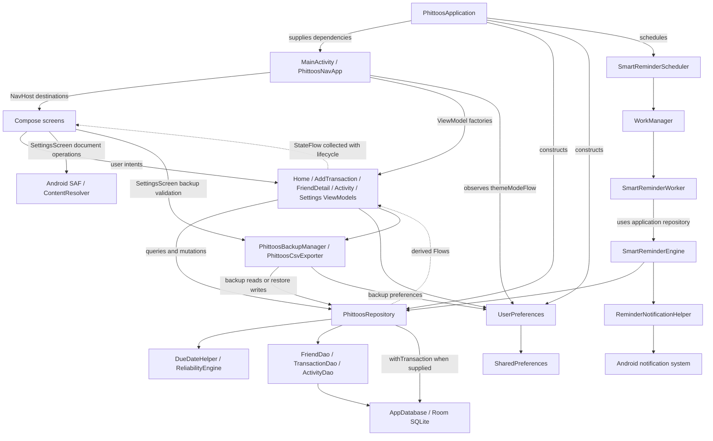
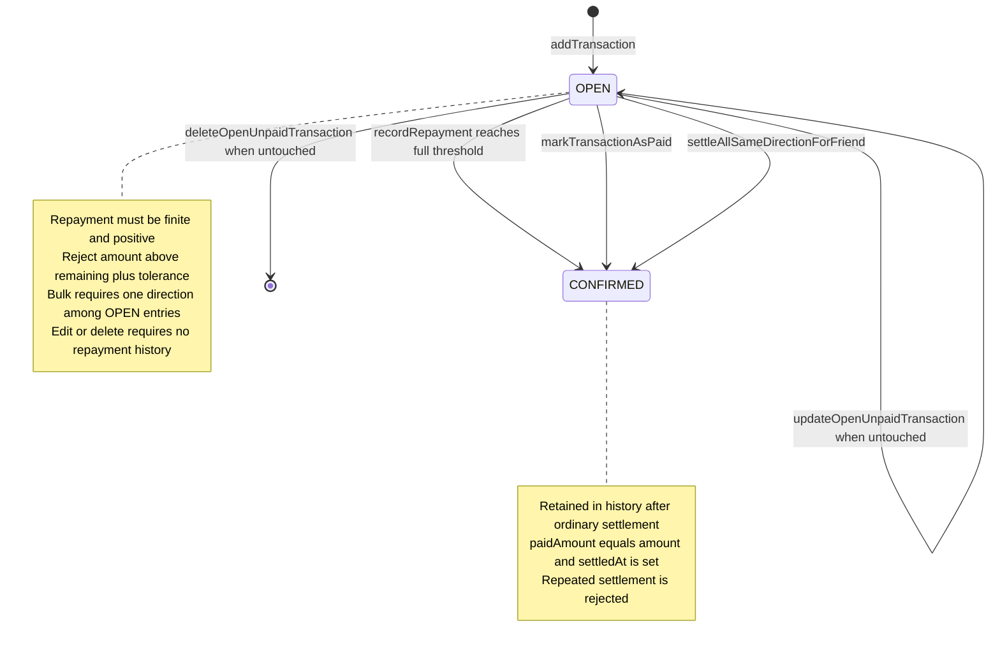
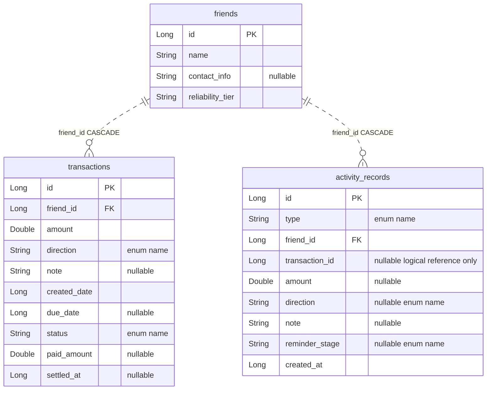
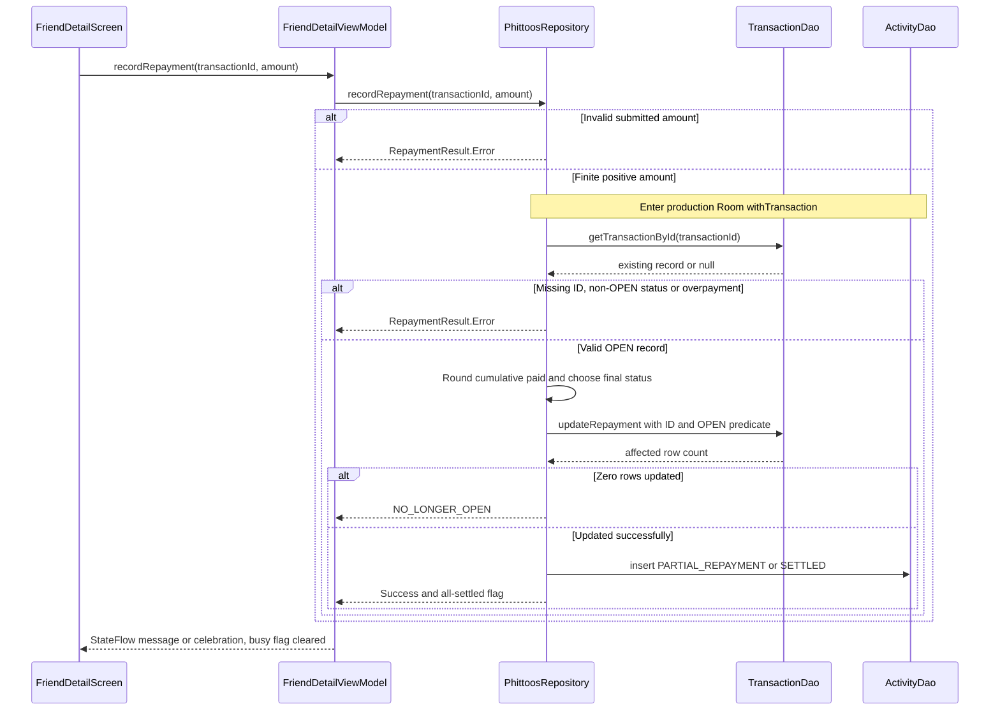

# Phittoos V1 Android architecture

## 1. Purpose and snapshot

Phittoos is a private person-to-person Android money ledger: **Tere mere hisaab… Phittoos!** This document describes the existing implementation for engineers reviewing or changing V1; it is not a redesign, V2 specification, or release certification.

| Snapshot | Evidence |
| --- | --- |
| Repository | [Professor1416/Phittoos](https://github.com/Professor1416/Phittoos) |
| Inspected source commit | `ee1bfbc169caa7a55403f80705e681bd438a15c9` |
| Branch / main comparison | Checkout `work`; HEAD and local `origin/main` equal remote `refs/heads/main` observed with `git ls-remote` |
| Inspection date | 2026-10-12, Asia/Calcutta |
| Initial working tree | Clean; no staged changes or non-ignored untracked files; this document was absent |
| Scope | Read-only source, test-source, build/manifest, history and retained-report inspection; only this Markdown file created |

**Observed** means identifiable code or retained artifact evidence. **Required policy** comes from [AGENTS.md](../AGENTS.md) and is not proof of complete enforcement. **Unverified** means runtime behavior or a guarantee was not established. **Proposed** means future work, not V1. Android builds/runtime tests were **NOT APPLICABLE — not run (documentation-only scope)**. Historical conversations are not implementation evidence; no conversation reader was available to retrieve the referenced threads.

[PROJECT_STATE.md](PROJECT_STATE.md) describes the preceding source snapshot `51913ed`; the intervening `ee1bfbc` commit added only PROJECT_STATE.md. App/test source is unchanged between those snapshots. Recheck source and verification when updating this document rather than assuming the SHA remains latest.

## 2. Architecture at a glance

V1 uses Compose screens, ViewModels with Flow/StateFlow, a central Room-backed repository, and focused date/reliability helpers. Dependencies are constructed directly by the Application and passed through ViewModel factories. There is no separate use-case layer, DI container, remote ledger, or authentication service.

The following current-V1 diagram shows principal call/dependency paths. Dashed state edges represent reactive results, not a separate stored balance model. Settings and background processing have additional paths alongside the normal screen/ViewModel flow.



Grouping ViewModels/export helpers in this diagram does not imply every ViewModel calls every helper. SettingsViewModel handles export/restore; the CSV helper formats supplied lists, while the backup manager reads repository/preferences and invokes restore. Compose also owns dialogs, provider streams and some validation. The source is pragmatic MVVM, not an absolute enforcement of pure presentation.

## 3. Module and package structure

[`settings.gradle.kts`](../settings.gradle.kts) includes one module, `:app`. Production Kotlin root: [`com.professor1416.phittoos`](../app/src/main/java/com/professor1416/phittoos).

| Relative package / path | Responsibility |
| --- | --- |
| `PhittoosApplication.kt`, `MainActivity.kt` | Process-owned dependencies, WorkManager configuration, theme/startup and navigation |
| `ui/navigation/Screen.kt` | Route names/builders for six destinations |
| `ui/screens/`, `ui/components/`, `ui/theme/`, `ui/util/` | Compose presentation, dialogs, semantic colors, formatting/resource messages |
| `ui/viewmodel/` | Five ViewModels and corresponding factories; observable screen state and user operations |
| `data/repository/` | Ledger operations, derived views, activity joins, transaction orchestration |
| `data/model/`, `data/dao/`, `data/db/` | Entities/read models, SQL access, schema/migrations/converters |
| `data/preferences/` | Local profile, onboarding, reminders, theme and backup timestamp |
| `domain/` | Date/delay calculations and owner-only reliability heuristic |
| `reminder/` | Scheduler, worker, qualification engine and notification delivery |
| `export/` | JSON backup validation/restore and CSV serialization |
| `app/src/test/`, `app/src/androidTest/` | JVM/Robolectric/Compose tests and one identity instrumentation test |

Declared stack: AGP 9.1.1, Gradle distribution 9.3.1, Compose compiler plugin 2.2.10, KSP 2.2.10-2.0.2, Compose BOM 2024.09.00, Navigation Compose 2.8.9, Lifecycle 2.8.7, Room 2.7.0, coroutines 1.10.2, WorkManager 2.9.1. App identity is `com.professor1416.phittoos`, version 1.0.0/code 1, min SDK 24, target 36, compile release 36 minor API 1. Java source/target compatibility is 11; that does not specify the build JVM used in prior cloud setup.

[`app/build.gradle.kts`](../app/build.gradle.kts) and [`libs.versions.toml`](../gradle/libs.versions.toml) distinguish applied dependencies from unused catalog entries. Firebase, network clients and credential-provider aliases are not instantiated V1 services. Google Services remains declared at root with `apply false`, not applied to the app. Only wrapper distribution properties are tracked, not wrapper executable scripts/JAR. None of these build files were changed.

## 4. Application startup and navigation

[`PhittoosApplication`](../app/src/main/java/com/professor1416/phittoos/PhittoosApplication.kt) lazily owns `AppDatabase`, `PhittoosRepository` and `UserPreferences`. The repository receives all three DAOs and the real database in production. The Application implements WorkManager `Configuration.Provider`; the manifest removes its default startup initializer metadata. `onCreate` ensures the notification channel and attempts daily scheduling, swallowing scheduling `Throwable`s. Scheduling is attempted even with reminders disabled; the worker later checks the preference.

[`MainActivity`](../app/src/main/java/com/professor1416/phittoos/MainActivity.kt) installs the splash screen, enables edge-to-edge, reads the initial notification friend extra, and observes `themeModeFlow` with `collectAsStateWithLifecycle`. `PhittoosNavApp` obtains Application dependencies and uses `viewModel(factory = ...)` within destinations. There is no independent service locator framework.

| Destination | Route / behavior |
| --- | --- |
| Onboarding | `onboarding`; local intro/name flow, writes preferences; completion replaces onboarding with home |
| Home | `home`; dashboard/search and navigation to ledger/settings/activity |
| Add/edit | `add_transaction?friendId={friendId}&transactionId={transactionId}`; optional positive IDs select contextual add or edit; absent arguments default to -1 |
| Friend detail | `friend_detail/{friendId}`; timeline, repayment/settlement, eligible edit/delete |
| Activity | `activity`; owner event history and needs-attention records |
| Settings | `settings`; profile/theme/reminders, backup/restore/export and delete everything |

Start destination is selected from `hasCompletedOnboarding`; this is local onboarding state, not authentication. Notification routing runs in `LaunchedEffect(initialFriendId)` when onboarding is complete: fetch friend on Dispatchers.IO, open friend detail if present, otherwise home. The notification also carries transaction ID, but navigation uses friend ID. No `onNewIntent` handler or transaction-specific notification route was found; reused-activity notification behavior is unverified.

ActivityScreen and FriendDetailScreen use `LifecycleResumeEffect`: activity starts/stops date regrouping; friend detail sets active-screen state and clears celebrations on pause/dispose. These are concrete screen lifecycle controls, not a general assertion that every date/status refresh survives all lifecycle changes.

## 5. Presentation and state management

| Owner | State and update behavior |
| --- | --- |
| `HomeViewModel` | Combines dashboard totals, friend balances, recent transactions and search query; filters/sorts friends; `stateIn(WhileSubscribed(5000))`, initial loading/zero state |
| `AddTransactionViewModel` | Private MutableStateFlow form; combines friend lists with form using Eagerly; validates input, friend/edit context and dates; saves through repository |
| `FriendDetailViewModel` | Combines friend/transactions with operation state using Eagerly; derives net/open count/bulk eligibility/reliability; tracks settling IDs, bulk/deletion flags, messages and celebration |
| `ActivityViewModel` | Combines needs-attention items, joined activity records and date-refresh trigger using WhileSubscribed(5000); injectable clock/timezone provider |
| `SettingsViewModel` | MutableStateFlow snapshots of preference/configuration state; explicit refresh/update, suspend export/restore/clear methods |
| Compose screens | Lifecycle-aware collection plus remembered dialog/picker/selection/submission state; rendering, validation affordances and navigation callbacks |

Balances are not stored in ViewModel state as authoritative ledger values: they are computed from Room-backed records. FriendDetailViewModel repeats balance derivation locally instead of delegating every calculation to the repository. Repayment dialog parses amounts and checks finite/positive/remaining bounds; date controls and save enablement also contain UI validation. SettingsScreen directly validates backup input and reads/writes content-provider streams.

Business rejections are structured as `RepaymentResult`, `EditTransactionResult`, `DeleteTransactionResult`, or settlement booleans/data. Friend-detail operations translate errors to UiMessage and clear busy flags in `finally`, but these blocks are not general catches for DAO failures. Add-save sets `isSaving` and performs repository work without a universal exception/finally reset. Settings catches selected export/restore/clear failures and shows messages. Do not infer consistent recovery for every exception/process death.

**Dashboard uncertainty:** HomeUiState initially contains zero totals/open count and `isLoading=true`; HomeScreen still renders the summary without checking this loading flag. Its summary uses positive/negative net first, then open count to distinguish “Overall balance ₹0” from “All settled up (₹0)”. An earlier retained test failed on initial all-settled text. Async loading/test synchronization is a plausible explanation, not a proven production-safe outcome (§14).

## 6. Domain and accounting engine

The main accounting engine is [`PhittoosRepository`](../app/src/main/java/com/professor1416/phittoos/data/repository/PhittoosRepository.kt) plus [`TransactionEntity`](../app/src/main/java/com/professor1416/phittoos/data/model/TransactionEntity.kt) extension properties, not a separate invented engine class.

For valid finite positive amounts:

```text
effectivePaidAmount = clamp(paidAmount or 0, 0, amount)
effectiveRemainingAmount = max(amount - effectivePaidAmount, 0)
receivable = sum(OPEN LENT remaining)
owed = sum(OPEN BORROWED remaining)
net = receivable - owed
```

LENT means the friend owes the owner; BORROWED means the owner owes the friend. Example with synthetic values: OPEN LENT ₹500 with ₹200 paid has ₹300 remaining; OPEN BORROWED ₹100 has ₹100 remaining; friend net is +₹200. Paying the LENT entry's remaining ₹300 removes that receivable from OPEN totals, leaving net -₹100 and the BORROWED entry open. Equal LENT/BORROWED remaining amounts produce zero net, not automatic settlement.

Amounts/paid/totals use `Double`. Repayment accumulation uses `round((currentPaid + repayment) * 100) / 100`; final settlement uses tolerance `amount - 0.005`; overpayment rejection uses `remaining + 0.0001`. Repository totals and friend-detail sums have no final rounding step. Formatting and CSV two-decimal presentation do not change stored precision. Invalid/extreme amounts are not made safe by merely describing these finite-value formulas.

| Required financial property | Observed enforcement / limitation |
| --- | --- |
| Correct direction and signed totals | Enum direction and OPEN-only sums in repository; mutations retain direction except explicitly eligible owner edits |
| Targeted repayment/settlement | Repository fetch by transaction ID; DAO update by ID with OPEN condition; activity derives friend/direction from fetched record. Individual APIs do not take an independent expected-friend argument |
| No negative remaining | Extension clamps remaining for valid values; not a validation guarantee for nonfinite/corrupt inputs |
| Paid accumulation and overpayment guard | Repository validates repayment and computes rounded paid value; preserves status until full threshold |
| Full settlement once / repeat no-op | Repository checks status and DAO `WHERE status='OPEN'`; only successful updates insert settlement activity. Simultaneous invocation evidence remains limited |
| Bulk direction safety | Repository refuses mixed LENT/BORROWED and empty sets before DAO bulk update; ViewModel also derives eligibility |
| Zero net is not settled | OPEN count tracked separately; no net-based mutation |
| Ordinary history retention | Settlement updates existing row and inserts event, without deleting it; deliberate eligible deletion/replace-restore/clear/cascades are separate destructive paths |
| Edit/delete restrictions | Repository and edit initialization refuse non-OPEN, positive paid/effective paid, or non-null settledAt; UI has related eligibility checks, with repository revalidation before mutation |
| Persistence/migration/restore safety | Production mutations use supplied Room transaction; separate preference writes, partial coverage and validation gaps prevent a blanket guarantee |

Date and reliability helpers do not move money. `ReliabilityEngine` derives a local LENT-only NEW/GREEN/YELLOW/RED heuristic, requiring two completed LENT records before non-NEW classification. It uses available settlement delays and overdue open records; GREEN can occur with no delay data, so it is not verified creditworthiness/on-time payment proof.

## 7. Transaction and repayment lifecycle

This current-V1 diagram shows normal owner mutation paths, not every enum value or the bulk restore/clear lifecycle. Rejected calls leave the financial state unchanged; successful persistence is assumed for each arrow.



`PENDING_CONFIRMATION` and `DISPUTED` are stored enum options and accepted by enum-based backup validation, but no corresponding V1 mutation workflow was found. They are deliberately absent from the state diagram. `DueDateHelper` recognizes pending-confirmation for date display; that does not implement mutual confirmation.

`recordRepayment` rejects invalid amounts, missing/non-OPEN records and overpayment, computes the new paid amount, and executes `updateRepayment`. Zero updated rows yield NO_LONGER_OPEN. Partial repayment keeps OPEN and null settledAt; it logs PARTIAL_REPAYMENT with the submitted amount. Full repayment sets CONFIRMED/paid=amount/settledAt and logs SETTLED with note `final_repayment` and the submitted amount.

`markTransactionAsPaid` sets paid=amount via `markAsConfirmed` and logs SETTLED for the pre-update remaining amount. Bulk selects the friend's OPEN entries, rejects mixed directions, calls `markAllOpenForFriendAsConfirmed`, and logs each remaining amount. Both compute remaining OPEN count afterward. FriendDetailViewModel celebrates only a successful all-settled outcome while its screen is active; delete/cancel and zero net do not generate that outcome.

## 8. Data model and database

[`AppDatabase`](../app/src/main/java/com/professor1416/phittoos/data/db/AppDatabase.kt) is Room schema **4**, database name `phittoos_database`, with `exportSchema=false`. SQL column names are shown below; nullable fields are identified in comments. Enum values serialize as text. Only enforced foreign keys are drawn.



Entities are `Friend`, `TransactionEntity`, `ActivityEntity`; Long IDs auto-generate. Transaction `friend_id` is indexed; activities index friend and creation time. `ActivityEntity.transactionId` has **no transaction foreign key**: repository explicitly deletes activities for eligible transaction deletion; backup validation checks referenced transaction existence but does not enforce matching activity/transaction friend IDs. DAO friend deletion cascades both children; this DAO operation exists even though ordinary settlement does not delete friends.

DAO reads expose Flow or suspend lists. Transactions display descending occurrence date; export is ascending occurrence then ID. Activities are descending event timestamp then ID. Insert methods use REPLACE conflict strategy, while repository creation normally supplies auto-generated IDs and restore reuses validated IDs. No database financial-value CHECK constraint or unique reminder-stage constraint was found.

`Converters` persists enum names. Unknown stored direction/status/activity type silently becomes LENT/OPEN/TRANSACTION_CREATED respectively; unknown nullable direction/stage becomes null. Backup enum validation instead rejects unknown names. Silent defaults are not evidence of corrupt-data recovery without financial reinterpretation.

| Migration | Source operation | Evidence limitation |
| --- | --- | --- |
| 1→2 | Add nullable `settled_at` to transactions | No complete v1 upgrade fixture found |
| 2→3 | Create activity_records, friend cascade and indices | ActivityReminderHistoryTest builds v2 fixture and opens through schema 4 |
| 3→4 | Add nullable `reminder_stage` | SmartReminderEngineTest builds v3 fixture and checks retained data/new stage field |

All migrations are registered; no destructive fallback is configured. These facts and tests do not prove every historical database upgrades safely.

Repository `runInTransaction` calls `database.withTransaction` **only if its optional database dependency is non-null**; otherwise it runs the block directly. Production supplies it, as do some tests; others omit it. Optional ActivityDao similarly permits mutation without event recording. DB commit scope is distinct from Flow emissions, provider operations, notifications and SharedPreferences (§11–13).

## 9. Main data and user flows

**Add LENT/BORROWED:** owner selects/adds a local friend → AddTransactionViewModel owns form/direction/date/note → save checks selected friend, parsed positive amount and date rules → repository rejects future occurrence calendar dates → transaction and TRANSACTION_CREATED event inserted in production Room transaction → returned ID/success callback → Room Flows update derived UI. `addNewFriend` is a separate insertion before transaction save. Repository creation does not repeat finite/positive amount or due-date validation.

**Repay/settle:** Compose selects the transaction and confirmation/input dialog → FriendDetailViewModel suppresses duplicate in-flight UI operations → repository applies guards and mutations. The sequence below consolidates repayment; individual/bulk settlement replace its arithmetic step with the guarded confirmation paths described in §7.



This is the production path with supplied ActivityDao; it does not model exceptions, rollback or every test constructor. Full repayment additionally reads the friend's OPEN count before returning. Returned success/state is not an external payment acknowledgment.

**Derived dashboard/friend balances:** TransactionDao emits records → repository filters OPEN and calculates separate LENT/BORROWED remaining totals → friend lists join/group by local friend ID → HomeViewModel combines search and recent records → Compose renders state. FriendDetailViewModel independently derives totals and same-direction eligibility from that friend's transaction Flow. No persisted “friend balance” column is incremented; recalculation follows data changes. Separate combined Flows can emit intermediate snapshots; there is no claimed atomic UI-frame guarantee.

**Eligible edit/delete:** route selects transaction for edit or detail dialog selects deletion → UI eligibility check → repository re-fetches and requires OPEN/no positive paid/no settledAt. Edit validates amount/dates, updates the transaction and matching creation event. Delete removes all activities for the transaction, then deletes its row. Production Room transaction groups database writes; derived totals recompute on Flow emission. Settled/repaid history is protected by these normal APIs, not universally immutable against clear/restore/DAO operations.

## 10. Date, due and reminder architecture

`createdDate` is occurrence time (default now, backdating supported); `dueDate` is optional due time; `settledAt` is successful full-payment/settlement time. Repayment/activity timestamps are independently recorded. Future-date rejection uses calendar-day comparison, so a later timestamp within today is allowed. Add form and edit repository reject past due calendar dates; new repository insertion alone does not enforce that rule.

[`DueDateHelper`](../app/src/main/java/com/professor1416/phittoos/domain/DueDateHelper.kt) normalizes date comparisons to noon in supplied/default timezone and classifies NONE/UPCOMING/DUE_TODAY/OVERDUE. Overdue/delay days use rounded millisecond difference divided by 86,400,000. Settled/non-open states show historical due information, not active overdue; transaction `dueInfo` also suppresses overdue when remaining is zero. This implementation is not a proof of all DST/timezone-change behavior.

ActivityViewModel has an injectable clock/timezone provider and resume/midnight grouping refresh, stopped on pause/clear. Its trigger updates Today/Yesterday grouping, not the upstream repository needsAttentionItems calculation. Home/FriendDetail have no matching midnight timer; derived overdue/reliability data reevaluates on relevant emissions or worker processing. Calendar rollover without data changes is a verification limit.

`SmartReminderScheduler` registers `phittoos_smart_reminder_check` every one day using KEEP. Its `triggerImmediateReminderCheck` helper defines a separate `phittoos_smart_reminder_check_immediate` job using one-time REPLACE, but no production caller was found. No network constraint is configured. Cancellation targets periodic work only. This is approximate Android background scheduling, not a promised daily wall-clock instant.

`SmartReminderWorker` obtains the Application repository, skips disabled reminders, then runs the engine; exceptions retry while `runAttemptCount < 3`, otherwise fail. Permission denial normally produces no posted notification, not an engine exception. The engine selects OPEN LENT entries with positive due date/remaining, evaluates overdue, and chooses the highest eligible unsent DAY_7/DAY_15/DAY_30 stage. Lower stages are skipped after a higher stage was sent; sequential already-sent checks suppress repeats.

Posting uses channel **`repayment_reminders`** and immutable PendingIntent; notification content includes friend label and outstanding amount. Helper checks notifications enabled and API-33 POST_NOTIFICATIONS permission. **No runtime permission-request call was found in production Kotlin** despite the declaration/check; actual onboarding or settings permission acquisition must not be assumed. Settings displays permission state. Delivery on a fresh Android-13+ install is unverified.

After sender success, repository records REMINDER_SENT with stage and amount. Notification and DB history are separate operations, without a unique stage constraint or transaction spanning delivery. Crash/overlap can invalidate an “exactly once” claim; no such guarantee is asserted. BORROWED/settled transactions never qualify for this engine's reminders. Only the owner is notified, not a borrower/friend.

## 11. Backup, restore, export and settings

`UserPreferences` uses MODE_PRIVATE `phittoos_prefs`: user name, onboarding flag, reminder flag (default true), theme and last-backup time. ThemeMode SYSTEM/LIGHT/DARK writes SharedPreferences and MutableStateFlow; MainActivity observes it and PhittoosTheme chooses semantic colors/system-bar appearance. Other preference reads are getter/refresh based, not a universal preference-change Flow.

[`PhittoosBackupManager`](../app/src/main/java/com/professor1416/phittoos/export/PhittoosBackupManager.kt) emits plaintext JSON format version 1 containing metadata, userName/onboarding/reminder preferences, friends, transactions and activities. Theme and last-backup time are not backed up. Export reads tables separately through suspend list methods, without a spanning snapshot transaction.

SettingsScreen reads selected JSON via OpenDocument, validates for a summary and asks the owner to confirm replacement. The manager validates again, parses lists, then calls `restoreValidatedData`. Validation checks required sections, names, positive unique IDs, finite amounts/paid bounds, enum names, friend existence and referenced transaction existence; it rejects CSV/newer format versions. It does not require exactly version 1 or prove timestamp, status/paid/settledAt or cross-friend activity consistency.

Restore deletes activities, transactions and friends, reinserts validated rows preserving IDs, then writes three preferences. **Only database operations participate in production Room withTransaction**. SharedPreferences setters issue separate `apply()` calls and cannot roll back with SQLite. The manager's database parameter itself does not establish the transaction; the supplied repository determines that boundary. On success, SettingsViewModel cancels notifications and reschedules/cancels periodic reminders. This is destructive replacement, not merge/sync.

[`PhittoosCsvExporter`](../app/src/main/java/com/professor1416/phittoos/export/PhittoosCsvExporter.kt) formats supplied lists, ordered by occurrence/ID, with columns `transaction_id,friend_name,direction,amount,paid_amount,remaining_amount,status,created_date,due_date,settled_date,note`. Amounts use effective paid/remaining properties. CSV quoting handles comma/quote/newline, but not spreadsheet formula prefixes. CSV is not restorable.

SettingsScreen owns pending export strings and CreateDocument contracts (`application/json`, `text/csv`), writes UTF-8 through ContentResolver, and clears pending data on cancellation/completion. Both callbacks use `openOutputStream(uri)?.use` and then report success; null output skips writing without throwing, and JSON last-backup time can still advance. This is a source-confirmed false-success possibility; provider reproduction was not run. Null/empty input is rejected on restore. Provider storage may be external/cloud, outside app retention control.

Delete-everything clears DB tables, then preferences, cancels notifications/periodic work, and returns navigation to onboarding. These side effects are not one cross-system transaction. It does not erase user-exported files.

## 12. Security and trust boundaries

V1 has no login, linked accounts, mutual confirmation, bank/payment processing or automatic remote ledger. Local ownership is enforced by app/device access, not a friend identity/server authorization system. Owner actions change the ledger's assertions; the app neither moves money nor verifies that payment occurred.

| Boundary | Observed behavior / limitation |
| --- | --- |
| App sandbox | Room SQLite and MODE_PRIVATE preferences; no application-level database encryption, app PIN or biometric gate found |
| User input → ledger | UI/repository guards differ; repository is the main mutation boundary but creation checks remain incomplete |
| Selected backup → local replacement | Plaintext JSON is untrusted input even when selected by the owner; validation and parsing precede destructive writes, with semantic/cross-store gaps |
| Local ledger → SAF provider | Explicit user document selection; full plaintext records/names/notes can leave app/device. Provider may store in cloud; deletion of local ledger does not revoke external copies |
| Local ledger → notification system | Friend label/amount rendered to OS notification surfaces; no explicit private-visibility override; lock-screen disclosure depends on platform/user settings |
| Launcher/notification → navigation | Exported launcher Activity; initial friend ID lookup checks existence, not remote identity. PendingIntent is immutable |

[`AndroidManifest.xml`](../app/src/main/AndroidManifest.xml) declares POST_NOTIFICATIONS, exported launcher MainActivity, non-exported startup provider, `allowBackup=false`, and no INTERNET or broad storage/contact/SMS/camera/location permissions. The retained debug merged manifest adds WorkManager/platform permissions including WAKE_LOCK, ACCESS_NETWORK_STATE, RECEIVE_BOOT_COMPLETED, FOREGROUND_SERVICE and app dynamic-receiver permission, without INTERNET. This is not a newly audited release permission inventory.

Backup rules are mostly templates: empty cloud-backup element, no explicit device-transfer section. Disabling backup in the manifest is intent/configuration, not proof of all OEM transfer behavior. No network client or sensitive Log/println calls were found in production searches; absence in inspected source is not a formal security audit or legal/privacy certification.

Documentation differences retained without edits: AGENTS.md's channel name `overdue_reminders` differs from actual `repayment_reminders`; its FileProvider guidance refers to no actual file_paths.xml; “strict semantic validation” and universal history immutability are policies broader than observed restore/destructive paths. PRIVACY.md mentions draft-sharing functionality absent from source. PROJECT_STATE.md already records these limitations; runtime notification-permission request absence is additionally explicit here.

## 13. Failure modes and consistency risks

These are architectural findings, not permission to fix implementation. A reproducible corrupted balance/history, wrong-target payment, unsafe migration or partial restore is **P0 / NO RELEASE** under AGENTS.md. Untested scenarios below are not labelled demonstrated corruption.

| Concern | Confirmed code-path evidence | What remains unverified |
| --- | --- | --- |
| Amount validation | New save parses positive value but lacks explicit finite check; digit/dot input has no length/precision bound; repository add lacks positive/finite amount check | Extreme-input acceptance/persistence and downstream failures; edits/repayments do have finite checks |
| Double/extreme values | Double storage/direct sums; rounding confined to repayment and formatting; helpers assume valid amounts | Precision drift, overflow, sub-cent rounding edge effects across real UI/storage paths |
| Simultaneous mutations | Production Room transaction plus conditional OPEN updates and UI busy flags; some test repositories omit database | True overlapping repay/settle/edit/delete stress and target isolation under races |
| Restore cross-store consistency | Preferences apply separately from Room transaction; manager uses repository transaction dependency | Commit-failure/process-death rollback of ledger plus preferences |
| Export consistency | Independent friend/transaction/activity list reads | Snapshot consistency while writes/clear/restore overlap |
| Provider false success | Nullable output-stream call followed by success/timestamp update | Specific provider returning null and resulting user recovery behavior |
| Reminder delivery/history | Post notification, then separately check/write stage event; no unique-stage constraint | Crash-window duplicate/lost history and overlapping immediate/periodic runs |
| Dashboard initial state | Loading zero state rendered as all settled; retained assertion failure | Whether failure is test timing only or user-visible misleading loading behavior |
| Converter/migration behavior | Silent enum defaults; v2/v3 fixtures, no exported schema history/full v1 fixture found | Corrupt legacy value consequences and complete real upgrade chain |
| Permission/lifecycle delivery | POST_NOTIFICATIONS declared/checked, no runtime request found; startup scheduling failures swallowed | Fresh-install posting, reused-activity routing, device sleep/boot and permission/revocation scenarios |

These observations preserve the limitations in PROJECT_STATE.md rather than upgrading existing feature presence into financial or release guarantees. No discovered bug was modified.

## 14. Testability and evidence

Test seams include repository constructor DAOs/database/activity dependency, in-memory Room, coroutine test dispatchers, explicit date/timezone arguments, ActivityViewModel clock/timezone functions, and SmartReminderEngine's injectable notificationSender/remindersEnabled inputs. Tests can exercise qualification without relying on physical notification delivery.

| Architecture area | Existing test source |
| --- | --- |
| Directions, totals, target/history/settlement | PhittoosAccountingEngineTest, AccountingStateCorrectnessTest, OfflineSettlementFlowTest |
| Partial/full repayment | PartialRepaymentEngineTest; `testK_concurrentRepaymentsCannotOverpay` is sequential, not overlapping execution |
| Edit/delete/backdating | ContextualAddAndWrongEntryRecoveryTest, TransactionDateBackdateTest |
| Calendar/reminders/activity | DueDateOverdueEngineTest, SmartReminderEngineTest, ActivityReminderHistoryTest (including resume/midnight grouping) |
| Backup/CSV/settings | PhittoosBackupRestoreTest, SettingsAndExportTest; failed-restore case rejects invalid references before replacement, not injected mid-commit failure |
| Reliability/theme/Compose UI | ReliabilityEngineTest, ThemePreferenceTest, celebration/accessibility/responsive/visual suites |

There are 25 JVM test-source files and one instrumented ExampleInstrumentedTest whose check is application ID, not financial end-to-end coverage. No tracked `.github` CI workflow was found. Tests constructed without database/activity dependencies cannot certify transactional history behavior merely by passing.

Read-only inspection of retained `app/build/test-results/testDebugUnitTest/TEST-*.xml` again shows **269 tests: 268 passed, 1 failure, 0 errors, 0 skips**. Failure: ExampleRobolectricTest's zero-net OPEN-record summary case, showing initial all-settled text. This is the previous retained run, not execution at this task's HEAD. Artifacts lack source-SHA attestation; preceding documentation connects them to onboarding at `67c777a`, and intervening commits changed only documentation. Earlier isolated class 12/12 and APK build/signature results remain historical reports, not new verification.

RELEASE_CANDIDATE.md's older 215-test PASS and unsigned release artifacts cannot certify this snapshot. No device QA, signed release, full regression PASS, universal migration safety or formal security audit is claimed. GreetingScreenshotTest writes a tracked screenshot, so future execution requires inspecting generated changes, not treating the suite as non-mutating.

Diagrams received manual source/structure review. No installed Mermaid parser/CLI was found; automated Mermaid syntax/render validation is **UNVERIFIED**. No tool installation or image generation was performed.

## 15. Architectural constraints for future changes

Preserve owner-only offline V1, direction-specific accounting, OPEN count separate from net, targeted mutations, repayment/settlement guards, ordinary history retention, safe migrations/restore and minimal permissions. Group splitting, budgeting, banking, lending, wallets, interest and payment processing remain outside product scope. Any money representation or persistence change needs its own authorized migration/testing work.

**Proposed only, not current:** optional linking/sharing/authentication/sync. Future decisions must establish ownership/consent, private-versus-shared records, revocation, trust boundaries, idempotency/replay defenses, conflict/history handling, deletion/privacy and offline compatibility. No backend, vendor, identity provider, storage library or conflict algorithm is chosen here. Unused enum/catalog entries do not authorize V2.

## 16. Verified source references

Paths below exist at snapshot `ee1bfbc169caa7a55403f80705e681bd438a15c9`; identifiers in preceding sections are navigation aids, not invented line anchors.

- [AGENTS.md](../AGENTS.md), [PROJECT_STATE.md](PROJECT_STATE.md): safety policy and prior evidence/risks; [PRIVACY.md](PRIVACY.md), [RELEASE_CANDIDATE.md](RELEASE_CANDIDATE.md): disclosures/historical claims, not fresh certification.
- [settings.gradle.kts](../settings.gradle.kts), [app/build.gradle.kts](../app/build.gradle.kts), [libs.versions.toml](../gradle/libs.versions.toml): actual module and dependency declarations.
- [PhittoosApplication.kt](../app/src/main/java/com/professor1416/phittoos/PhittoosApplication.kt), [MainActivity.kt](../app/src/main/java/com/professor1416/phittoos/MainActivity.kt), [Screen.kt](../app/src/main/java/com/professor1416/phittoos/ui/navigation/Screen.kt): dependency creation/startup/navigation.
- [HomeViewModel.kt](../app/src/main/java/com/professor1416/phittoos/ui/viewmodel/HomeViewModel.kt), [AddTransactionViewModel.kt](../app/src/main/java/com/professor1416/phittoos/ui/viewmodel/AddTransactionViewModel.kt), [FriendDetailViewModel.kt](../app/src/main/java/com/professor1416/phittoos/ui/viewmodel/FriendDetailViewModel.kt), [ActivityViewModel.kt](../app/src/main/java/com/professor1416/phittoos/ui/viewmodel/ActivityViewModel.kt), [SettingsViewModel.kt](../app/src/main/java/com/professor1416/phittoos/ui/viewmodel/SettingsViewModel.kt): state ownership, factories and mutation callers.
- [PhittoosRepository.kt](../app/src/main/java/com/professor1416/phittoos/data/repository/PhittoosRepository.kt): `runInTransaction`, `dashboardTotals`, `friendsWithBalance`, `addTransaction`, `recordRepayment`, `markTransactionAsPaid`, `settleAllSameDirectionForFriend`, edit/delete and `restoreValidatedData`.
- [Friend.kt](../app/src/main/java/com/professor1416/phittoos/data/model/Friend.kt), [TransactionEntity.kt](../app/src/main/java/com/professor1416/phittoos/data/model/TransactionEntity.kt), [ActivityEntity.kt](../app/src/main/java/com/professor1416/phittoos/data/model/ActivityEntity.kt), [DAOs](../app/src/main/java/com/professor1416/phittoos/data/dao), [AppDatabase.kt](../app/src/main/java/com/professor1416/phittoos/data/db/AppDatabase.kt), [Converters.kt](../app/src/main/java/com/professor1416/phittoos/data/db/Converters.kt): ER fields/constraints, SQL guards, migrations and conversion behavior.
- [DueDateHelper.kt](../app/src/main/java/com/professor1416/phittoos/domain/DueDateHelper.kt), [ReliabilityEngine.kt](../app/src/main/java/com/professor1416/phittoos/domain/ReliabilityEngine.kt), [ReminderStage.kt](../app/src/main/java/com/professor1416/phittoos/data/model/ReminderStage.kt), [reminder package](../app/src/main/java/com/professor1416/phittoos/reminder): date, heuristic and delivery behavior.
- [UserPreferences.kt](../app/src/main/java/com/professor1416/phittoos/data/preferences/UserPreferences.kt), [PhittoosBackupManager.kt](../app/src/main/java/com/professor1416/phittoos/export/PhittoosBackupManager.kt), [PhittoosCsvExporter.kt](../app/src/main/java/com/professor1416/phittoos/export/PhittoosCsvExporter.kt), [SettingsScreen.kt](../app/src/main/java/com/professor1416/phittoos/ui/screens/settings/SettingsScreen.kt): storage split, input validation, formats and SAF streams.
- [HomeScreen.kt](../app/src/main/java/com/professor1416/phittoos/ui/screens/home/HomeScreen.kt), [FriendDetailScreen.kt](../app/src/main/java/com/professor1416/phittoos/ui/screens/frienddetail/FriendDetailScreen.kt), [ActivityScreen.kt](../app/src/main/java/com/professor1416/phittoos/ui/screens/activity/ActivityScreen.kt): actual rendering/validation and lifecycle callbacks.
- [AndroidManifest.xml](../app/src/main/AndroidManifest.xml), [backup_rules.xml](../app/src/main/res/xml/backup_rules.xml), [data_extraction_rules.xml](../app/src/main/res/xml/data_extraction_rules.xml): source permission/backup configuration.
- [JVM test sources](../app/src/test/java/com/professor1416/phittoos), [PartialRepaymentEngineTest.kt](../app/src/test/java/com/professor1416/phittoos/PartialRepaymentEngineTest.kt), [PhittoosBackupRestoreTest.kt](../app/src/test/java/com/professor1416/phittoos/PhittoosBackupRestoreTest.kt), [ExampleInstrumentedTest.kt](../app/src/androidTest/java/com/professor1416/phittoos/ExampleInstrumentedTest.kt): assertion coverage and explicit limitations.

Retained build/test artifacts are ignored local files, not portable repository evidence. No secrets, personal ledger records, or user backup contents were accessed; synthetic accounting examples are illustrative. Documentation validation does not upgrade any unverified runtime claim.
