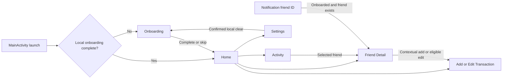

# Phittoos V1 design system and UI/UX reference

## 1. Document purpose and snapshot

| Snapshot | Inspected evidence |
| --- | --- |
| Repository | Professor1416/Phittoos |
| Branch / source SHA | `work` / `fa8c30f4ba4457e407b196ca7771187ea4ef49dd` |
| Remote main | Same SHA observed with `git ls-remote origin refs/heads/main` |
| Inspection date | 2026-10-12 UTC |
| Scope | Current Compose UI, resources, navigation, test sources and available logo previews; documentation only |
| Initial state | Clean index/working tree; DESIGN.md absent |

Audience: designers, Android engineers, QA and future coding agents. This describes existing V1 and approved obligations, not a redesign or visual/accessibility certification. **APPROVED DESIGN RULE** is normative intent; **IMPLEMENTED IN CURRENT SOURCE** identifies code/assets; **PARTIAL / DESIGN GAP** identifies unmet intent; **NOT VERIFIED** covers runtime/device/visual claims; **PROPOSED FUTURE** is outside current V1. Source definitions and test assertions do not establish screen fidelity by themselves.

The six prior documents remain references: [AGENTS](../AGENTS.md), [PROJECT_STATE](PROJECT_STATE.md), [ARCHITECTURE](ARCHITECTURE.md), [RULES](RULES.md), [SECURITY](SECURITY.md), [PRD](PRD.md). Their earlier snapshot SHAs are intentional; subsequent commits through this baseline added documentation only. No Android builds/tests, new screenshots or device checks were performed here.

## 2. Product experience and design principles

**APPROVED DESIGN RULE:** premium financial minimalism: clear money/direction, calm hierarchy, friendly language and low effort, with owner privacy and honest state. Phittoos records informal LENT/BORROWED exchanges, not payments or friend agreement. Keep one-to-one ledger context visible before destructive or settlement actions.

Rupee amounts, remaining obligations and actionable labels take precedence over decoration. Pair semantic colors with text/icons. Preserve history and reject unsafe corrections. Loading, empty and zero-net OPEN are different states; success must follow the intended persisted action. Accessibility and predictable offline operation are requirements, not measured achievements. Avoid ornamental effects that obscure accounting; source is the baseline, not an external mockup.

## 3. Brand identity and logo usage

Name: **Phittoos**. Exact locked tagline: **Tere mere hisaab… Phittoos!** The [approved brand specification](branding/PHITTOOS_BRAND_V1.md) locks Slate `#0F172A`, White `#FFFFFF`, Emerald `#10B981`, Orange `#F97316` for logo/launcher/splash/approved branding, not every Compose surface.

The approved emblem uses a corrected white ₹ between opposed emerald/orange directional arrows. Do not substitute a plain ₹, handshake, vertical-pillar approximation or redesigned icon. Refer to the brand file for 108dp viewport/path geometry and Material Symbols Apache-2.0 source notes rather than copying paths here.

**Inspected assets:** [foreground vector][foreground], [background vector][background], [monochrome vector][monochrome], [adaptive icon][adaptive] with background/foreground/monochrome references, density-specific legacy/round WebP resources. [themes.xml][splash] sets Slate splash background, foreground drawable and post-splash theme; MainActivity calls installSplashScreen before startup. The XML name `windowSplashScreenAnimatedIcon` does not prove an animated vector or verified startup timing.

Available [logo_after.png](../logo_preview/logo_after.png), [48px preview](../logo_preview/logo_48px_preview.png), [circular mask](../logo_preview/logo_mask_circular.png) and [squircle mask](../logo_preview/logo_mask_squircle.png) were visually inspected: white ₹ and colored arrows on Slate, including simulated masked/small previews. These static assets are not current rendered screen screenshots or physical launcher QA. Multi-device clipping, native themed-icon tint/monochrome recognition and splash transitions remain **NOT VERIFIED**. The tracked `app/src/test/screenshots/greeting.png` is not recognized as PNG by `file` and could not be decoded by the image viewer; no screen appearance is inferred from it. No image was repaired/regenerated.

## 4. Color system and semantic tokens

[Color.kt][color] defines FinancialColorScheme, LightFinancialColors, DarkFinancialColors, LocalFinancialColors and `PhittoosColors.financial`. [Theme.kt][theme] supplies Material and financial schemes together. SYSTEM follows `isSystemInDarkTheme`; LIGHT/DARK explicitly select. `dynamicColor=false` is a parameter but is unused: no dynamic wallpaper palette selection exists even when callers pass true.

Actual Material mappings (opaque hex):

| Material role | Light | Dark |
| --- | --- | --- |
| primary / onPrimary | `#047857` / `#FFFFFF` | `#10B981` / `#090D16` |
| background / onBackground | `#F8FAFC` / `#0F172A` | `#0F172A` / `#FFFFFF` |
| surface / onSurface | `#FFFFFF` / `#0F172A` | `#1E293B` / `#FFFFFF` |
| surfaceVariant / onSurfaceVariant | `#F1F5F9` / `#334155` | `#334155` / `#E2E8F0` |
| primaryContainer / onPrimaryContainer | `#F1F5F9` / `#0F172A` | `#1E293B` / `#FFFFFF` |
| secondary / onSecondary | `#0D9488` / `#FFFFFF` | `#0D9488` / `#FFFFFF` |
| secondaryContainer / onSecondaryContainer | `#CCFBF1` / `#0F172A` | `#334155` / `#FFFFFF` |
| tertiary / onTertiary | `#F97316` / `#FFFFFF` | `#F97316` / `#FFFFFF` |
| outline / outlineVariant | `#E2E8F0` / `#F1F5F9` | `#334155` / `#1E293B` |

Financial mappings:

| Financial token | Light | Dark | Meaning |
| --- | --- | --- | --- |
| lentContainer / onLentContainer / lentAccent | `#DCFCE7` / `#065F46` / `#047857` | `#064E3B` / `#6EE7B7` / `#34D399` | Receivable from friend |
| borrowedContainer / onBorrowedContainer / borrowedAccent | `#FFEDD5` / `#9A3412` / `#C2410C` | `#7C2D12` / `#FDBA74` / `#FB923C` | Owner owes friend |
| settledContainer / onSettledContainer | `#DCFCE7` / `#065F46` | `#064E3B` / `#6EE7B7` | Settled treatment, not payment proof |
| overdueContainer / onOverdueContainer / overdueAccent | `#FEE2E2` / `#991B1B` / `#DC2626` | `#7F1D1D` / `#FCA5A5` / `#F87171` | Overdue urgency |
| partialContainer / onPartialContainer | `#FEF3C7` / `#92400E` | `#78350F` / `#FCD34D` | Partial/caution |
| cardBackground / chipBackground | `#FFFFFF` / `#F1F5F9` | `#1E293B` / `#334155` | Neutral surfaces |

Material roles not explicitly overridden retain library defaults; do not infer every error role equals overdueAccent. Tokens are available but usage is screen-specific; hardcoded/avatar colors also exist. No contrast ratio was measured here. Some test sources calculate selected-color contrast, which does not certify every alpha/background combination, theme or screen. Preserve accounting meaning (PRD FR-004/006/011; FIN-001–006), not exact branding colors for all text.

## 5. Typography and number formatting

[Type.kt][type] overrides only bodyLarge: FontFamily.Default, Normal, **16sp**, lineHeight **24sp**, letterSpacing **0.5sp**. Other Material typography roles are defaults; commented titleLarge/labelSmall examples are not overrides. No custom font family/assets are instantiated by this file. Screens mix Material roles with local weight/size overrides rather than one comprehensive typography token system.

Observed examples: Add/Edit uses a **36sp** decorative ₹ and **32sp** bold amount field; the decorative symbol's semantics are cleared while the input has the rupees label. Reliability uses Material label styles, with **10sp** privacy text and **18sp** summary lineHeight. Bold amounts/headings and lower-emphasis helper text form the hierarchy, with many local definitions; small text needs actual readability checks.

[Formatters][formatters] uses default locale: whole currency → ₹ plus grouped Long, fractional → ₹ plus two decimals. Date labels are Today/Yesterday, otherwise `d MMM` or `d MMM yyyy`; full date is `dd MMM yyyy`, time `h:mm a`, with timezone-aware helpers where parameters exist. Do not promise Indian lakh grouping on every locale. Add-save feedback has separate amount formatting, so consistent extreme/locale presentation is **PARTIAL / DESIGN GAP**. Double storage/rounding is unchanged by formatted two-decimal text; amount bounds/high precision are unresolved engineering gates.

Paid, original and remaining must be distinguishable; net must not conceal opposite OPEN entries. `sp` supports scaling but does not prove unclipped large text. Alignment, truncation and long labels/amounts must be checked on actual screen sizes (§15/17).

## 6. Spacing, shapes, iconography and elevation

No centralized spacing/shape/elevation scale was found alongside the three theme files; dimensions are mostly local `dp` values. Examples are observations, not new universal tokens:

| Source pattern | Observed definition |
| --- | --- |
| Home TopSummaryCard | 24dp corners; 16dp horizontal/8dp vertical external padding; 20dp inner padding; 2dp elevation |
| Home summary children | 16dp corners; 12dp spacing; stack when available width <340dp |
| Home FriendRowItem / RecentActivityRow | 18dp / 16dp card corners respectively |
| Add/Edit bottom save surface | 8dp shadow elevation; 16dp padding plus navigation-bar inset |
| Add/Edit field / quick chips | Amount 14dp corners; horizontal chip row spaced 8dp |
| ReliabilityPill | 6dp corners; 7dp horizontal/2dp vertical text padding |
| FriendDetailReliabilitySection | 14dp corners; 14dp horizontal/12dp vertical padding |
| AvatarInitial | CircleShape, default 44dp visual size; size-dependent text |

Material cards/surfaces, outlined fields, buttons, chips, icon buttons and an extended Home Add FAB are used. Avatars are decorative identity cues, not evidence every clickable target is 44dp; interactive hit bounds need separate verification. Icons use Compose Material filled/auto-mirrored icons, plus resource vectors for branding. Decorative icons often have null descriptions alongside text; actionable icons have labels such as Back, Settings, Activity History and repayment-specific descriptions. Divider/card/alpha patterns remain screen-local. Future standardization would require separate authorization; this document does not refactor duplication.

## 7. Application navigation and information architecture

[Screen.kt][routes] defines six areas: `onboarding`, `home`, `add_transaction?friendId={friendId}&transactionId={transactionId}`, `friend_detail/{friendId}`, `activity`, `settings`. Add route covers contextual friend entry and edit mode; there is no separate transaction-detail destination or friend-confirmation screen.

Normal Back behavior returns via navigation callbacks; arrows do not promise back-stack state restoration on process death. [MainActivity][main] chooses start from local preferences and collects theme lifecycle-aware; notification initial friend ID lookup routes to existing friend detail or Home fallback. Transaction extra is carried but no transaction-specific destination found; reused-activity routing lacks onNewIntent handling and is **NOT VERIFIED**. Mermaid manually reviewed; automated syntax/rendering **UNVERIFIED** because no parser was available. No V2 node is current.

## 8. Home dashboard experience

[HomeScreen][home] contains HomeHeader, TopSummaryCard, SearchAndFilterBar, FriendRowItem, RecentActivityRow and separate empty illustrations/guidance. Greeting/branding, Activity/Settings actions, gross “You'll get back”/“You owe”, net summary, friend list, search and Add/quick friend actions provide the entry point. Recent transaction rows derive from repository-backed recent records; do not confuse these with the dedicated activity-event history.

TopSummaryCard switches summary boxes from row to column below **340dp** available width. FriendRowItem also uses constraint-based branches. Gross direction colors remain explicit. Net copy is positive “You'll receive…”, negative “You need to pay…”, zero with OPEN count “Overall balance ₹0”, otherwise “All settled up (₹0)”. Friend names/amounts must remain associated through wrapping/truncation.

Empty ledger guidance differs from no search match; both are source implementations, not newly verified visuals. HomeUiState starts with zero/loading and HomeScreen does not gate summary on isLoading: **PARTIAL / DESIGN GAP**, potentially showing all-settled before Room state arrives. Retained dashboard assertion failed on that text; exact production impact/root cause remains unverified. Required UX: neutral loading/unknown state before loaded totals, and never equate equal opposite OPEN amounts with no obligations (FR-006/011/024; FIN-006).

## 9. Add/Edit transaction experience

[AddTransactionScreen][add] is a scrolling form with top Back and bottom Save, IME/navigation-bar padding. Direction choices expose mutually exclusive radio semantics/selectableGroup. Friend search selects existing or creates a local friend; contextual entry/edit can lock friend context. Notes and separate occurrence/due date pickers are present. Occurrence supports past/today; normal-form due supports absent/today/future; future occurrence/past due show errors.

Selected friend plus empty amount triggers FocusRequester; failure is caught. Amount uses KeyboardType.Number and ImeAction.Next, one line and rupees label/error supporting text. Repayment dialog uses Decimal keyboard separately; keyboard declaration does not prove decimal accessibility on every IME. Quick amount chips **+100/+200/+500/+1000/+2000/+5000** increment rather than replace, in a horizontal scroll row; test sources assert practical 48dp targets.

Save enablement uses friend validity, positive parsed amount, due-date validity and busy state; ViewModel rechecks dates/context. Edit labels change and initializes existing eligible values; repository revalidates eligibility. Back is navigation, not an implemented universal unsaved-change prompt. UI amount filtering/checks are not authoritative finite/range/precision validation: repository creation lacks matching safeguards and extreme input/save error recovery remain gaps (FR-005/013/024, MON/TX rules). Do not claim keyboard filters prevent all malformed/overflow amounts.

## 10. Friend detail and repayment experience

[FriendDetailScreen][detail] shows local friend identity, balances/reliability, transaction history and per-entry actions. Entry context distinguishes direction, original/paid/remaining and due/status information. OPEN versus settled presentation is not another user's confirmation. Record repayment selects one transaction; finite positive input is checked against remaining, with a fill-remaining action and Cancel. Full payment and explicit settlement use owner confirmation/context, update only intended target and retain history.

Same-direction bulk is available only for eligible nonempty OPEN sets; mixed LENT/BORROWED refuses bulk, requiring individual action. Net zero never authorizes closure. UI busy/settling-ID flags suppress repeated interactions but do not replace repository guards/concurrency verification.

Untouched OPEN edit/delete are context actions; settled/repaid records reject normal direct correction. Delete confirms; Cancel preserves. Aggregate eligibility does not fully inspect repayment-event history, so corrupt/zero-rounded history cases are unverified. Success celebration requires successful settle/full repayment, no OPEN records and active detail screen; no celebration for delete, canceled action or zero net. PRD FR-007–014/018 and FIN-007–014 govern visible meaning. None of these dialogs proves external payment or friend agreement.

## 11. Activity experience

[ActivityScreen][activity] displays NeedsAttentionCard, grouped ActivityRowCard and EmptyActivityState. Owner-visible events include creation, partial repayment, settlement and posted reminders; attention items use current due information, distinct from persisted event rows. A mapped BECAME_OVERDUE enum does not establish automatic generation for every due-state transition.

Occurrence date describes the original exchange; activity createdAt describes event time; due date describes expected repayment day. Backdated creation and later repayments must not be grouped as if they occurred together. ActivityViewModel refreshes grouping on resume and at local midnight while active, cancels on pause/clear; its regroup trigger does not itself refresh upstream needs-attention calculations. Home/Detail lack matching midnight timers. Lifecycle/date rollover/timezone freshness remains **NOT VERIFIED** beyond inspected definitions/test coverage.

## 12. Settings, export and destructive action UX

[SettingsScreen][settings] groups PROFILE, appearance, REMINDERS, YOUR DATA, ABOUT and DANGER ZONE. Profile dialog saves/cancels name; theme rows select System default/Light/Dark. Reminder toggle and current permission state are shown. POST_NOTIFICATIONS declaration/checking is not a production runtime request flow; no acquisition call found. Do not call fresh-install delivery verified.

“Back up your data” creates JSON through provider selection; “Restore from backup” reads/validates summary then “Restore & Replace” or Cancel. Replacement removes current local ledger rather than merges. “Export as CSV” creates a viewing/sharing copy, not restorable backup. Supported backup preferences exclude theme/last-backup timestamp. Onboarding skip may leave blank name while backup validation requires nonblank profile; compatibility needs verification (PRD §18).

Both output callbacks use nullable openOutputStream then success; null can skip writing yet advance backup time/report success: **PARTIAL / DESIGN GAP**, source-confirmed flow, provider reproduction not run. Throw/cancel handling exists but does not clear that gap. Restore semantics/cross-store rollback are incomplete; UI confirmation is not a safety certificate.

“Clear all data” confirms local DB/preferences removal and return to onboarding; external plaintext JSON/CSV/provider copies remain. Required disclosure: files can leave through a user-selected cloud provider; local-first is not encrypted export or guaranteed recovery/erasure. Notification financial content and OS transfer behavior also need privacy/device review. FR-019–024 and SECURITY controls apply.

## 13. Reusable component inventory

| Actual composable / source | Inputs and responsibility | Organization / limits |
| --- | --- | --- |
| [AvatarInitial][avatar] | name, modifier, size default 44dp; first trimmed uppercase character or “?”; hash-based eight-color circle | Shared ui/components; visual identity only, not authentication |
| [ReliabilityPill][badge] | ReliabilityLevel, modifier; New/Green/Yellow/Red text plus semantic color | Defined in ReliabilityBadge.kt; no composable actually named ReliabilityBadge |
| [FriendDetailReliabilitySection][badge] | ReliabilityInfo, modifier; heading, pill, summary, “Only you can see this” with lock | Shared file; 10sp privacy text needs readability QA |
| [SettlementCelebrationDialog][celebration] | event, optional friendName, onDismiss, modifier, enableAnimation | Friend-detail package; actual event popup with animation/accessibility |
| [SettlementCelebrationCard][celebration] | Compatibility wrapper in same file | Do not mistake filename for sole active implementation |
| HomeHeader, SummaryBox, TopSummaryCard, SearchAndFilterBar, FriendRowItem, RecentActivityRow | Screen-specific dashboard/card/search rendering | Private in HomeScreen.kt; not a shared component library |
| NeedsAttentionCard, ActivityRowCard, EmptyActivityState | Attention/history/empty rendering | Private in ActivityScreen.kt |
| SettingsSection, SettingsClickableRow, ThemeOptionRow | Group headings, actions, theme selection | Private in SettingsScreen.kt |

Form/dialog/card patterns also occur in Add/FriendDetail. Similar local patterns are an organization observation, not authorization to consolidate. Props and exact dimensions should be rechecked at linked source when reused.

## 14. UI state and feedback contract

The expectation column is **APPROVED DESIGN RULE**, even when enforcement is partial.

| State | Required visible truth | Current implementation / verification |
| --- | --- | --- |
| Loading/unknown | No all-settled assertion until loaded | Home gap; friend/activity lifecycle collection exists, not universal recovery proof |
| Empty/no search match | Explain no records versus no matches; relevant add/clear-search action | Separate Home states/Activity empty source; visuals unverified |
| Invalid input | Specific error tied to field/action; no false saved record | Amount/date/context errors; extreme creation validation incomplete |
| Saving/busy | Suppress accidental repeats; restore actionable state after failure | Save/settling flags present; Add lacks universal exception/finally reset |
| Partial payment | Show cumulative paid/remaining, still OPEN, correct target event | Source/dialog/repository; overlap/boundary testing incomplete |
| Full settlement/repeat | One successful closure/history; repeat no duplicate effect | Conditional guards/sequential tests; no proven external payment |
| Due/overdue | Distinguishable labels/icons; settled not active overdue | Tokens/helper source; timezone/midnight freshness unverified |
| Mixed bulk | Refuse without mutation; preserve individual actions | Repository/ViewModel guard; UI/device QA outstanding |
| Export canceled/failed/completed | Only completed real stream means success/backup timestamp | Cancellation/throws handled; nullable output false-success gap |
| Persistence failure | Honest failure/recovery without partial history or stale success | Structured business errors and some catches; crash/rollback gates unresolved |
| Celebration | Active-screen success plus zero OPEN; no false money transfer claim | Event gating/clear-on-pause present; device timing unverified |

Color/animation cannot substitute for explicit status. Source/test presence alone is not a completed acceptance result.

## 15. Accessibility and responsive behavior

Source uses lifecycle collection, scaffold/inset padding, scroll containers, labels/descriptions, test tags and selected/radio semantics. Auto-mirrored navigation/trend icons exist; manifest supportsRtl=true is not full RTL QA. Test tags aid automation but are not spoken labels. Coverage pointers: [AddTransactionAccessibilityTest](../app/src/test/java/com/professor1416/phittoos/AddTransactionAccessibilityTest.kt), [OnboardingAccessibilityTest](../app/src/test/java/com/professor1416/phittoos/OnboardingAccessibilityTest.kt) and [SettingsAccessibilityTest](../app/src/test/java/com/professor1416/phittoos/SettingsAccessibilityTest.kt). Decorative null descriptions are appropriate only when equivalent text carries meaning; verify merged semantics/focus in TalkBack.

Existing Add/FriendDetail/Onboarding/Settings accessibility tests assert selected controls ≥48dp, direction radio roles, amount error/label and large text. Home responsive tests exercise constrained widths and 200% font scale/long names, checking amount bounds. LayoutAndSystemInsetsTest checks layout/insets; theme tests cover persistence and semantic palette choices. Add selected-color contrast assertions are limited source evidence, not measured whole-app WCAG compliance here.

**APPROVED DESIGN RULE:** practical 48dp interaction targets, readable contrast, clear paid/remaining labels, scale text without hidden actions/amounts, correct scroll/IME/navigation insets, no color-only states. **NOT VERIFIED:** actual TalkBack ordering/announcements, every long amount/name, all screens in portrait/landscape/tablet/RTL, native keyboards, system font variants, OEM bars, full contrast measurement and motion preferences. No formal accessibility certification. Check supported devices and both fixed themes plus system switching rather than extrapolating from Robolectric.

## 16. Motion, celebrations and transitions

Onboarding uses AnimatedContent with fadeIn/fadeOut for its two steps. MainActivity uses NavHost without a custom centralized animation system; library defaults are not a designed/tested transition specification. No general bespoke list animation contract was established. Splash resources define icon/background; device startup motion/timing remains unverified.

[SettlementCelebrationDialog][celebration] keys effects by event.id: popup scale 0.92→1 and fade over **250ms**; checkmark after **80ms**, duration **220ms**; headline after **150ms**, fade/scale **200ms**; dismissal fade **150ms**. These are code definitions, not measured frame performance. It announces accessible support text, reads animator/transition global scales and disables animation when zero or enableAnimation=false. The setting is remembered at composition, not a universal live preference listener.

Nominal auto-dismiss is **3000ms**, adjusted with AccessibilityManager recommended timeout on API29+, with older touch-exploration fallback **10000ms**. Explicit dismissal remains important; TalkBack/device timing and focus must be tested. FriendDetail lifecycle clears events on pause; celebration is not approval by the friend. No confetti/redesign recommendation or new motion asset is authorized.

## 17. Design quality assurance matrix

Priority is review triage, not a newly reproduced bug severity. Any demonstrated financial corruption follows AGENTS P0 / NO RELEASE; existing P1/P2 gaps are not fabricated exploits.

| Screen/component | Key requirement | Existing source/test evidence | Missing device/manual check | Priority |
| --- | --- | --- | --- | --- |
| All themes | Fixed financial meanings under Light/Dark/System | Color/Theme; [ThemePreferenceTest][themetest] | System toggles, every surface/error contrast | P1 financial meaning / P2 visual |
| Logo/splash | Correct ₹/arrows, native mask/tint readability | Vectors/XML and viewed static previews | OEM launchers, monochrome tint, splash/mask clipping | P2 |
| Home | Long names/large amounts remain associated | [HomeScreenResponsiveLayoutTest][responsive] | 200% font, landscape/tablet/RTL/device | P1 hidden financial content |
| Six areas | Meaningful TalkBack labels/focus and target sizes | Accessibility test classes; semantics source | Actual spoken traversal/dialog focus/IME | P1 critical action / P2 polish |
| Home/detail/add | LENT/BORROWED and mixed direction explicit | FR-004/011; financial tokens/settlement tests | Color-independent comprehension | P1 |
| Home summary | Zero-net OPEN differs from loading/settled | Home source; [ExampleRobolectricTest][dashboardtest] | Diagnose loading; await actual state; no early settled | P1 |
| Repayment dialog | Target context, cumulative remaining, duplicate-tap safety | [FriendDetailAccessibilityTest][detailtest], Partial suite | Repeated taps/real overlap, keyboard boundaries | P1 |
| Due/activity | Today/overdue/settled dates truthful | DueDate and activity tests | Midnight, DST/timezone, resume freshness | P1 state / P2 date presentation |
| Edit/delete | Only untouched correction; cancel safe | Recovery suite / dialogs | Wrong target, history-based eligibility and errors | P1 |
| Settings providers | Honest stream success and confirmed restore | Settings/backup test source; null stream gap | Null/throwing provider and interruption recovery | P1 |
| Reminders | Permission/owner disclosure and safe denial | Helper/engine checks; request missing | Fresh install, lock screen, denial/boot/Doze | P1 release gate / P2 delivery |
| Celebration | Success/zero OPEN/active gating; accessible motion | [SettlementCelebrationTest][celebrationtest], [visual refinement tests][motiontest] | Disabled motion, TalkBack timeout/focus, low-end device | P2; P1 false outcome |
| Insets/navigation | Actions not obscured by bars/IME | [LayoutAndSystemInsetsTest][insettest]; source padding | Gesture/3-button/OEM bars, rotations | P1 obscured action / P2 layout |

Prior retained run: **269 tests, 268 passed, one failed dashboard assertion**, no errors/skips. No fresh suite, screenshot comparison or physical QA was run here. Test names containing visual/accessibility do not establish current device appearance. The unreadable tracked greeting image is not a valid visual baseline for this review.

## 18. V1/V2 boundary and design change guardrails

Preserve six-area owner-only V1, locked tagline/logo, financial direction, net-zero OPEN distinction, history, eligible corrections, honest loading/success and minimal permissions. A visual refactor must not alter balances, repayment thresholds, bulk eligibility, migration/restore or business state. Preserve source-backed acceptance FR and FIN IDs rather than treating old mockups as implementation authority.

No external redesign/reskin, Stitch replacement, assets or implementation is authorized. **PROPOSED FUTURE:** shared/linking/confirmation/auth/sync UI. Future questions concern consent, private/shared records, who sees/changes state, revocation and understandable conflict/history feedback. No collaborative screen, vendor or interaction layout is approved here.

## 19. Source references and unresolved design gaps

Snapshot: `fa8c30f4ba4457e407b196ca7771187ea4ef49dd`. Recheck linked definitions after code changes; retain evidence labels and update QA against exact artifacts. Governing references: [AGENTS](../AGENTS.md), [PROJECT_STATE](PROJECT_STATE.md), [ARCHITECTURE](ARCHITECTURE.md), [RULES](RULES.md), [SECURITY](SECURITY.md), [PRD](PRD.md), [brand](branding/PHITTOOS_BRAND_V1.md). Additional source: [Onboarding][onboarding], [ActivityViewModel](../app/src/main/java/com/professor1416/phittoos/ui/viewmodel/ActivityViewModel.kt), [HomeViewModel](../app/src/main/java/com/professor1416/phittoos/ui/viewmodel/HomeViewModel.kt), [AddTransactionViewModel](../app/src/main/java/com/professor1416/phittoos/ui/viewmodel/AddTransactionViewModel.kt), [FriendDetailViewModel](../app/src/main/java/com/professor1416/phittoos/ui/viewmodel/FriendDetailViewModel.kt), [preferences](../app/src/main/java/com/professor1416/phittoos/data/preferences/UserPreferences.kt), [Application](../app/src/main/java/com/professor1416/phittoos/PhittoosApplication.kt), [strings](../app/src/main/res/values/strings.xml), [manifest](../app/src/main/AndroidManifest.xml).

Material unresolved gaps: premature Home settled/loading presentation; monetary input/display bounds; Add error/busy recovery; untouched-history edge eligibility; null-provider false success; restore semantic/cross-store recovery; runtime notification acquisition; clock freshness; profile-skip backup compatibility; device accessibility/branding/RTL/motion validation. These are findings, not permission to fix. SECURITY/PRD already record generic AGENTS channel/FileProvider/permission wording and privacy draft-sharing discrepancies; those documents remain unchanged.

Available logo previews support only static brand inspection. No decoded full-screen screenshot was available; historical design conversations were not independently retrieved (no conversation reader available) and are not design authority. No personal records/secrets were inspected. Validation here is document/source/link/scope review, not a green UI regression or visual certification.

[color]: ../app/src/main/java/com/professor1416/phittoos/ui/theme/Color.kt
[theme]: ../app/src/main/java/com/professor1416/phittoos/ui/theme/Theme.kt
[type]: ../app/src/main/java/com/professor1416/phittoos/ui/theme/Type.kt
[avatar]: ../app/src/main/java/com/professor1416/phittoos/ui/components/AvatarInitial.kt
[badge]: ../app/src/main/java/com/professor1416/phittoos/ui/components/ReliabilityBadge.kt
[formatters]: ../app/src/main/java/com/professor1416/phittoos/ui/util/Formatters.kt
[routes]: ../app/src/main/java/com/professor1416/phittoos/ui/navigation/Screen.kt
[main]: ../app/src/main/java/com/professor1416/phittoos/MainActivity.kt
[home]: ../app/src/main/java/com/professor1416/phittoos/ui/screens/home/HomeScreen.kt
[add]: ../app/src/main/java/com/professor1416/phittoos/ui/screens/addtransaction/AddTransactionScreen.kt
[detail]: ../app/src/main/java/com/professor1416/phittoos/ui/screens/frienddetail/FriendDetailScreen.kt
[activity]: ../app/src/main/java/com/professor1416/phittoos/ui/screens/activity/ActivityScreen.kt
[settings]: ../app/src/main/java/com/professor1416/phittoos/ui/screens/settings/SettingsScreen.kt
[onboarding]: ../app/src/main/java/com/professor1416/phittoos/ui/screens/onboarding/OnboardingScreen.kt
[celebration]: ../app/src/main/java/com/professor1416/phittoos/ui/screens/frienddetail/SettlementCelebrationCard.kt
[foreground]: ../app/src/main/res/drawable/ic_launcher_foreground.xml
[background]: ../app/src/main/res/drawable/ic_launcher_background.xml
[monochrome]: ../app/src/main/res/drawable/ic_launcher_monochrome.xml
[adaptive]: ../app/src/main/res/mipmap-anydpi-v26/ic_launcher.xml
[splash]: ../app/src/main/res/values/themes.xml
[themetest]: ../app/src/test/java/com/professor1416/phittoos/ThemePreferenceTest.kt
[responsive]: ../app/src/test/java/com/professor1416/phittoos/HomeScreenResponsiveLayoutTest.kt
[dashboardtest]: ../app/src/test/java/com/professor1416/phittoos/ExampleRobolectricTest.kt
[detailtest]: ../app/src/test/java/com/professor1416/phittoos/FriendDetailAccessibilityTest.kt
[celebrationtest]: ../app/src/test/java/com/professor1416/phittoos/SettlementCelebrationTest.kt
[motiontest]: ../app/src/test/java/com/professor1416/phittoos/SettlementCelebrationVisualRefinementTest.kt
[insettest]: ../app/src/test/java/com/professor1416/phittoos/LayoutAndSystemInsetsTest.kt
