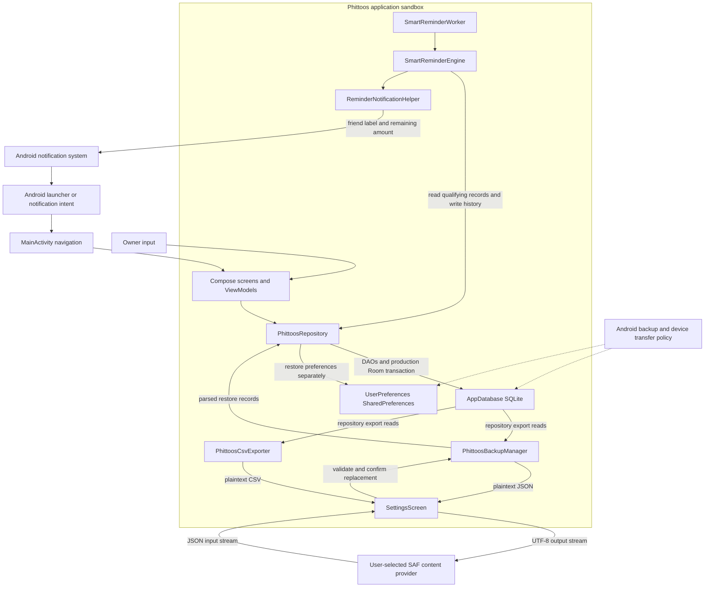

# Phittoos V1 security architecture and threat model

## 1. Security purpose and snapshot

| Item | Inspected baseline |
| --- | --- |
| Repository | Professor1416/Phittoos |
| Branch / source commit | `work` / `4fc1a270b0966f01a265b8b49763a04647f8e7e5` |
| Remote main | Same SHA observed through `git ls-remote origin refs/heads/main` |
| Inspection date | 2026-10-12 UTC |
| Scope | Current Android V1 source, test source, Git history, existing documents and retained local artifacts |
| Baseline working tree | Clean; SECURITY.md absent |

This document supports maintenance, security review and release gates. It is descriptive plus explicit required controls, not a completed penetration test, legal compliance assessment or release approval. [AGENTS.md](../AGENTS.md) governs engineering; [RULES.md](RULES.md) defines financial obligations; [ARCHITECTURE.md](ARCHITECTURE.md) and [PROJECT_STATE.md](PROJECT_STATE.md) explain implementation and evidence history.

**OBSERVED** means a source/artifact fact. **PROVEN CODE GAP** means an absent check or unsafe control-flow possibility directly identifiable in source, not a reproduced exploit. **UNVERIFIED EXPLOIT/FAILURE** means the runtime prerequisites/outcome have not been established. **REQUIRED MITIGATION** is policy, not current compliance. **REPORTED** is historical testimony. **NOT APPLICABLE** excludes nonexistent V1 surfaces. Control statuses in §13 distinguish PRESENT, PARTIAL, MISSING, UNVERIFIED and FUTURE/NOT APPLICABLE. Code/test presence alone does not prove correctness.

No build, runtime/security test, device check, dependency audit or exploit reproduction was run for this documentation task. Retained artifacts lack a commit-bound security attestation. Referenced conversations are historical context, not implementation evidence. Remote main may advance; refresh the snapshot after source changes.

## 2. System and security boundaries

Phittoos is an offline-first, owner-only Android ledger for informal money lent to and borrowed from friends. **Tere mere hisaab… Phittoos!** V1 has no login, shared server, automatic sync, mutual confirmation, banking, wallet, interest, payment processing, group splitting or budgeting. Recording settlement is the owner's assertion; it does not transfer or independently verify money.

Arrows through Room summarize DAO access, not direct database access by exporters. SettingsViewModel mediates export/restore actions but is omitted to keep the boundary diagram readable. Notification posting, provider writes and preferences are outside the SQLite transaction. Platform dotted edges identify a policy boundary requiring verification, not proven enabled transfer. No backend/authentication/payment node exists in V1. Mermaid was manually reviewed; automated rendering/syntax validation is **UNVERIFIED**.

## 3. Protected assets and adversary assumptions

| Asset | Security property / consequence of loss |
| --- | --- |
| Amount, direction, paid/remaining, status | Integrity: incorrect receivable/owed amounts or false settlement |
| Friend IDs/names/contact information and notes | Confidentiality and target integrity: disclosure or wrong-person association |
| Occurrence/due/settlement times and activities | Accountability: owner-visible history must match actual ledger operations |
| Preferences/profile/reminder state | Availability and consistency with restored ledger; private profile data |
| JSON/CSV and external copies | Confidentiality, usable recovery and honest export success |
| Signing keys, build inputs and credentials | Authentic application distribution; credential confidentiality |

Threat sources include ordinary mistakes/repeated taps, crafted imports selected by the owner, malfunctioning or untrusted SAF providers, crashes/process death, overlapping operations, damaged legacy databases, and another app interacting with reachable Android components. A malicious application does not automatically have Room access: reaching private files generally requires additional compromise, privilege or platform failure. Physical/device access can expose the owner UI; there is no app authentication gate.

Assume supported Android sandbox behavior on an uncompromised device, not protection against root, compromised OS, unlocked-device access or forensic erasure. Local friend identities are neither authenticated users nor verified credit information. No V1 server, network API, remote identity or payment attack surface is modeled.

## 4. Threat model and risk methodology

Threat IDs are stable review references. STRIDE categories are used only where they match actual surfaces: tampering, disclosure, denial of service and history repudiation/ambiguity. Likelihood is **UNKNOWN** without deployment/device measurements; prerequisites below are not measured probabilities. Confidence is high for cited code facts, limited for unexecuted runtime outcomes. Severity is provisional under §15, with P0 reserved for demonstrated integrity failures.

| Threat | Surface / prerequisites | Impact and observed controls | Evidence / provisional gate |
| --- | --- | --- | --- |
| THR-V1-001 | Invalid/extreme amount reaches creation API or form | Invalid ledger/arithmetic; edit/repay reject nonfinite values, creation does not repeat those checks | PROVEN CODE GAP; [repository][repo], [add form][addvm]; P1, corruption outcome UNVERIFIED |
| THR-V1-002 | Replayed/overlapping repay or settle calls | Duplicate effects, lost payment or wrong event; OPEN predicates, target fetch and production transactions present | [DAO][txdao], [partial tests][partial]; P1 concurrency gate, sequential replay coverage present |
| THR-V1-003 | Wrong target supplied or mixed-direction bulk selected | Wrong person's ledger/history; fetched target metadata and mixed-direction rejection present | [repository][repo], [settlement tests][settlement]; overlap/incorrect caller selection UNVERIFIED |
| THR-V1-004 | Corrupt legacy DB, unsafe upgrade or destructive API misuse | History/balance loss or silent reinterpretation; FKs and registered migrations present | [database][db], [converters][converters]; P1 full-upgrade gate |
| THR-V1-005 | Owner selects crafted JSON with inconsistent records | Invalid history/state imported; structural/reference/amount validators partial | [backup][backup]; PROVEN CODE GAP, P1 semantic gate |
| THR-V1-006 | Large selected input or process interruption during replacement | Memory exhaustion, unavailable restore or cross-store inconsistency | Unbounded read and separate preference writes observed; runtime failure UNVERIFIED; P1 recovery / P2 size-robustness gate |
| THR-V1-007 | Provider returns null/fails, or export overlaps writes | False backup confidence, partial/inconsistent plaintext copy | Null-success control flow and separate reads observed; [settings UI][settings]; P1 backup gate |
| THR-V1-008 | External provider retains file or spreadsheet interprets field | Financial disclosure or formula interpretation outside app | Explicit SAF selection/CSV quoting present; confidentiality and formula controls partial; P2 review, impact-dependent escalation |
| THR-V1-009 | Notification visible on lock screen; crash/overlap around posting | Disclosure, duplicate/missing reminder history | Permission checks/immutable intent present; visibility and post/history atomicity limited; P2, escalate corrupted history if reproduced |
| THR-V1-010 | Another app launches exported component or OS transfers data | Unexpected UI entry/disclosure; launcher intentional, startup provider private | [manifest][manifest]; no intent-triggered financial mutation found; release/device gates UNVERIFIED |
| THR-V1-011 | Compromised build/signing/dependency input | Malicious or unauthentic distribution | External signing bindings and declared dependencies observed; audit/reproducibility NOT RUN; P1 release gate |
| THR-V1-012 | Initial Home state or stale date flow shown as authoritative | Misleading all-settled/overdue decision | Loading state exists but display gate missing; retained failed assertion; P1 correctness gate, runtime cause UNVERIFIED |

No threat row establishes arbitrary code execution, unauthorized remote access or a reproduced financial exploit. REQUIRED MITIGATION: validate authoritative boundaries, preserve target/history consistency, test recovery and report failures honestly, using the rule IDs below.

## 5. Financial input and balance tampering

[RULES.md](RULES.md) FIN-001–018 and MON-001–004 apply. LENT is receivable, BORROWED is owed; only OPEN remaining amounts contribute, and net = receivable − owed. Zero net can coexist with open obligations. Direction must not be inferred from a signed input amount or silently changed.

**Observed:** Double is stored, raw nullable paid defaults to zero and is clamped to `[0, amount]`; remaining is clamped at zero. Totals are direct Double sums. `addTransaction` rejects future occurrence days but lacks positive/finite amount and due-date checks. AddTransactionViewModel filters digits/dot and checks parsed positivity but lacks explicit finite, input length and precision limits. Edit and repayment reject nonpositive/NaN/infinite values. Room has no financial CHECK constraints.

**Required / gap:** authoritative creation must reject malformed, zero, negative, NaN, Infinity and overflow; define safe range and paise precision without silently rewriting legacy records. Display rounding/clamping is not validation. Extreme scaling/sums and tiny high-precision payments require tests. Do not assert that every invalid number can reach storage from ordinary UI: parsing, SQL and serialization behavior require reproduction. Representation changes require separate authorization, migration and regression coverage. Reproduced wrong balances/history are P0 / NO RELEASE.

## 6. Repayment and settlement abuse

`recordRepayment` validates submitted amount, fetches intended ID, requires OPEN, rejects payment above remaining + **0.0001**, rounds cumulative paid using `round(value * 100) / 100`, and treats paid ≥ amount − **0.005** as full. Full sets paid=amount, CONFIRMED and settledAt; partial remains OPEN with null settledAt. Events use the fetched friend/direction and submitted payment; final event is SETTLED with `final_repayment`. Individual settlement records pre-update remaining. FIN-007–011/014 and PAY/BULK rules govern these semantics.

DAO repayment/confirmation updates require matching ID and OPEN status, return affected counts, and do not create an event on zero-row failure. Repeated settled calls fail without new financial effects in inspected sequential paths. Production supplies both database and ActivityDao, grouping row/event writes in Room; optional test construction can omit these protections. ViewModel in-flight flags are additional UI defenses, not authoritative race proof.

Bulk rejects empty/mixed-direction sets, updates only intended friend's OPEN records and creates per-record remaining-amount events. Net-zero is not a settlement trigger. Actual overlap of partial payments, full settlement, bulk, edit/delete and restore remains UNVERIFIED; `testK_concurrentRepaymentsCannotOverpay` is sequential. Required tests must assert unrelated rows, cumulative paid, event count, direction and timestamps under actual overlap. No wrong-target exploit or race was reproduced here.

## 7. Financial history and database integrity

Normal edit/delete require OPEN, no positive raw/effective paid and null settledAt; edit preserves ID/friend and updates creation history. Deletion explicitly removes all target activities and eligible row. Guards do not query repayment events or require raw paid exactly null/zero for corrupt records: tiny zero-rounded history/corrupt aggregates need verification (TX-002). Ordinary settlement retains history; eligible deletion, friend DAO CASCADE, replacement restore, delete-everything and uninstall are separate destructive semantics, not immutable audit storage.

Room **v4** contains Friend, TransactionEntity and ActivityEntity. Both child friend IDs are enforced CASCADE foreign keys; activity transactionId is only a logical reference. Inserts use REPLACE; invoking them with existing IDs needs overwrite/cascade scrutiny. Production `runInTransaction` uses the supplied database; without it the repository runs the block directly. Financial multi-write tests must use the actual dependency.

Registered migrations 1→2 add settled_at, 2→3 add activities/indices, 3→4 add reminder_stage; no destructive fallback. `exportSchema=false`, no exported schema history/full v1 upgrade fixture found. Existing v2/v3 fixtures do not certify every historical upgrade. Unknown stored direction/status/activity type falls back to LENT/OPEN/TRANSACTION_CREATED; unknown nullable direction/stage becomes null. This may reinterpret corrupt legacy data rather than reject it; obtaining/tampering with the private database is a separate prerequisite. DB/FIN-016–018 require explicit compatibility and retained-balance/history verification, not silent destructive recovery.

## 8. Malicious backup and restore threats

JSON is untrusted even when manually selected. `validateBackup` checks required sections, nonblank profile/friend names, positive unique IDs, valid enums, finite positive amounts, paid within bounds, friend existence and optional transaction existence. CSV/newer backup versions are rejected; generated format is version **1**. Validation/parsing occur before replacement, and Settings requests owner confirmation.

**Proven code gaps:** version logic rejects sentinel −1 and values >1 rather than exactly supported versions; status/paid/settledAt/timestamp consistency is incomplete; activity friend can exist while differing from the referenced transaction's friend; matching direction/event semantics are not enforced. Valid enum names can include unused V1 statuses, without implementing their workflows. No backup authentication/encryption guarantees provenance. A valid-looking manually modified backup is not independently confirmed payment history.

Settings reads the entire provider stream via `readBytes()` and parses JSON without an observed size/record/nesting bound. Resource exhaustion is an UNVERIFIED runtime outcome, not a demonstrated exploit. Required tests use bounded synthetic input and verify safe failure; do not stress real financial data/devices.

`restoreValidatedData` clears and reinserts three tables in production Room transaction, preserving imported IDs. Preference setters issue separate `apply()` writes inside that block; SQLite cannot roll those back. The manager's database parameter does not independently create the transaction. Validation rejection preserves old records before destruction; the existing failed-restore test does not inject commit failure or process death. Required recovery testing covers DB rollback, preferences, restart and notification/work state after interruption; no all-store atomicity claim is justified (BACK-001–003, FIN-017–018).

## 9. Export and content-provider security

JSON and CSV contain plaintext names, notes, amounts and history; JSON includes profile/settings. User-authorized SAF selection can send copies to external/cloud providers without app-controlled networking. The app cannot control provider retention, sharing or deletion after export. CSV is not a restorable backup.

Exporter reads friends/transactions/activities separately, without a shared read snapshot. Concurrent clear/restore/mutations can produce inconsistent export; the actual outcome is UNVERIFIED. Backup omits theme and last-backup timestamp. A successful round-trip must compare complete supported ledger fields rather than formatting alone.

Both Settings callbacks use `openOutputStream(uri)?.use` then success messages; JSON also advances last-backup time. A null output skips writing but follows success control flow: **PROVEN CODE GAP**, not a provider test performed here. Thrown write/flush/close errors reach failure handling; cancellation clears pending state. Required success means a non-null stream completed write/flush/close, with no success/timestamp on failure. Provider partial files and recovery behavior need synthetic tests.

CSV quoting handles commas, quotes and newlines, but not formula-leading strings such as a synthetic `=1+1` note/name. Spreadsheet interpretation depends on consumer/import settings; this is not code execution in Phittoos. Require a deliberate consumer-safety policy/test and clear plaintext disclosure (BACK-004–006).

## 10. Android platform and permission security

Source manifest declares POST_NOTIFICATIONS, exported launcher MainActivity, private startup provider and `allowBackup=false`; no INTERNET, contacts, broad storage, SMS, camera, location or microphone permission is declared. No FileProvider/file_paths.xml was found. SAF uses user-selected URI streams rather than broad file access.

Retained **debug**, not freshly generated release, merged manifest adds WAKE_LOCK, ACCESS_NETWORK_STATE, RECEIVE_BOOT_COMPLETED, FOREGROUND_SERVICE and the app's dynamic-receiver permission. WorkManager SystemJobService is exported with BIND_JOB_SERVICE; DiagnosticsReceiver and ProfileInstallReceiver are exported with DUMP. SystemAlarm/SystemForeground services, constraint/reschedule receivers, Room invalidation service and startup provider are non-exported. Debug tooling adds exported PreviewActivity and ComponentActivity. Exported does not alone establish an exploitable financial surface; permissions and variant-specific inclusion must be checked. Fresh merged release review is UNVERIFIED.

MainActivity initially routes a positive friend extra only after onboarding and an existence lookup; the transaction extra does not initiate mutation. No intent-driven repayment/restore path was found. Reused-activity routing/device interaction tests remain unrun; launcher access is not an authentication control.

Notification helper checks app notifications and API-33 POST_NOTIFICATIONS but production runtime permission acquisition was not found. Declaration/checking is not a request flow. Channel is `repayment_reminders`, DEFAULT importance; explicit MainActivity PendingIntent is immutable/update-current. Notification includes friend/amount, without explicit private visibility override: lock-screen exposure depends on OS/user settings.

WorkManager periodically checks approximate one-day/KEEP work; immediate helper has no production caller found. Engine targets OPEN LENT positive remaining with reached 7/15/30-day stage. Posting precedes history write, with no unique stage constraint/spanning transaction; crash/overlap can undermine exactly-once claims. Permission denial safely returns non-posting, but fresh-install delivery, boot/Doze, duplicate stages and timezone/DST remain verification gates.

Backup/extraction XML are largely templates, with empty cloud-backup and no explicit device-transfer section. `allowBackup=false` expresses intent, not guaranteed no OEM/device transfer. Review actual supported platform behavior before confidentiality claims.

## 11. Secrets, build and supply-chain security

[App build](../app/build.gradle.kts) declares release signing conditionally on a keystore file, using environment-backed password bindings/path configuration; debug uses a separate debug keystore. Neither credential values nor signing material were inspected/copied into this document. Required: keep production keys out of source/logs/export, restrict signing access and verify distribution signature independently. Release minification is disabled; obfuscation is not a financial or encryption control.

Secrets Gradle plugin is active; root Google Services declaration is apply-false, not app activation. Unused Firebase/network/identity catalog aliases do not prove installed services. The active stack is described in PROJECT_STATE.md; dependency declarations are not resolved/transitive vulnerability clearance. Dependency/CVE audit, reproducible-build comparison and current signed-release provenance checks are **NOT RUN**. No vulnerable package or clean supply chain is asserted. No tracked CI workflow was found. Older release-candidate statements and retained debug output are not a current signed-release security approval.

## 12. Privacy, data lifecycle and user control

Room SQLite and MODE_PRIVATE SharedPreferences are local sandbox storage. No application-level encrypted database/preferences, app PIN or biometric gate was found; Android/device protections are separate. Source searches found no production network client or sensitive Log/println usage; this is bounded source evidence, not a formal no-telemetry attestation of every resolved binary.

Delete-everything clears DB then preferences, cancels notifications/periodic work and returns onboarding; these effects are not one cross-system transaction. It cannot revoke external JSON/CSV, provider backups, screenshots or previously exposed notification contents. Uninstall normally removes app sandbox data under Android control; no forensic or all-transfer erasure guarantee follows.

[PRIVACY.md](PRIVACY.md) correctly describes owner-controlled plaintext SAF exports and replacement restore, but draft share-sheet reminder functionality is not found in source, and its “only” notification permission wording omits merged library permissions. [PLAY_DECLARATIONS.md](PLAY_DECLARATIONS.md) acknowledges ACCESS_NETWORK_STATE but its blanket “no data transmitted off-device” wording needs the explicit external SAF exception; its release-manifest claims are historical, not verified anew here. AGENTS.md names `overdue_reminders` and generic FileProvider guidance, differing from actual channel/no provider. Its permission-request, strict semantic-validation and immutable-history language must be distinguished from observed gaps/destructive paths. Existing documents are unchanged.

No DPDP, Google Play policy, WCAG, vulnerability-free, formally audited encryption or legal compliance certification is made. Release disclosures must match actual artifact behavior and external-copy limitations.

## 13. Security control matrix

Status describes current evidence, not whether the required property is fully satisfied. Refer to RULES.md for acceptance details rather than treating this table as duplicate financial logic.

| Control ID | Required security property | Observed enforcement / status | Gap / limitation | Verification method | Evidence |
| --- | --- | --- | --- | --- | --- |
| SEC-V1-001 | Valid finite monetary creation, FIN-015/MON | PARTIAL: edit/repay guards | Creation/range/precision incomplete | UI plus direct API extremes | [repository][repo], [add form][addvm] |
| SEC-V1-002 | Correct direction/totals, FIN-001–006 | PRESENT: OPEN remaining by direction | Double/loading boundaries need evidence | Mixed-direction and zero-net assertions | [accounting tests][accounting], [Home][home] |
| SEC-V1-003 | Target isolation/idempotency, FIN-007–010/014 | PARTIAL: ID/OPEN guards and fetched metadata | Real overlap unverified | Concurrent calls, unrelated rows/events | [DAO][txdao], [partial tests][partial] |
| SEC-V1-004 | Safe bulk, FIN-011 | PRESENT: mixed/empty rejection | Overlap/count/event equivalence unverified | Atomic bulk failure/overlap | [settlement tests][settlement], [repository][repo] |
| SEC-V1-005 | Protected historical corrections, FIN-012–014 | PARTIAL: aggregate eligibility and event updates | No repayment-event eligibility query | Corrupt/zero-rounded history rejection | [recovery tests][recovery] |
| SEC-V1-006 | Safe identity/upgrade, FIN-016/018 | PARTIAL: friend FKs, migrations, no destructive fallback | Logical transaction link, enum defaults, full v1 gap | Legacy upgrade/tamper fixtures | [database][db], [converters][converters] |
| SEC-V1-007 | Reject malicious semantic imports, FIN-017 | PARTIAL: structural/ID/enum/amount checks | Cross-friend/status/time/version gaps | Synthetic malformed backup matrix | [backup][backup], [backup tests][backuptests] |
| SEC-V1-008 | Bounded import availability | MISSING: no observed input-size/record bound | Whole stream buffered | Safe bounded resource tests | [settings UI][settings] |
| SEC-V1-009 | Recoverable replacement, BACK-003 | PARTIAL: production Room transaction | Preferences/OS side effects separate | Commit failure/process-death recovery | [repository][repo], [preferences][prefs] |
| SEC-V1-010 | Honest coherent export, BACK-004/005 | PARTIAL: explicit picker, exception handling | Null-success and separate reads | Null/throwing provider and snapshot tests | [settings UI][settings], [backup][backup] |
| SEC-V1-011 | External data disclosure/consumer safety | PARTIAL: user SAF selection and CSV quoting | Plaintext retention/formula handling | Provider disclosure and spreadsheet review | [CSV][csv], [privacy](PRIVACY.md) |
| SEC-V1-012 | Least privilege/component protection | PARTIAL: no INTERNET, private provider, immutable intent | Release/component/device review unrun | Merged release plus intent tests | [manifest][manifest], [notification][notification] |
| SEC-V1-013 | Permission and notification confidentiality | PARTIAL: permission checks | Request flow missing; lock-screen policy unverified | Fresh install/denial/lock-screen | [notification][notification], [settings UI][settings] |
| SEC-V1-014 | Honest reminder history | PARTIAL: stage checks, log after post | No atomic exactly-once delivery/history | Crash window and overlap injection | [engine][engine], [reminder tests][remindertests] |
| SEC-V1-015 | Private storage and transfer limits | UNVERIFIED: sandbox/allowBackup intent observed | No app encryption/auth; OEM transfer untested | Device/backup/data lifecycle review | [preferences][prefs], [extraction][extraction] |
| SEC-V1-016 | Authentic audited distribution | UNVERIFIED: signing configuration observed | Dependency/provenance audit NOT RUN | Authorized release signature/dependency audit | [app build](../app/build.gradle.kts) |
| SEC-V1-017 | Shared-server object authorization | FUTURE/NOT APPLICABLE: no V1 shared server | Proposed V2 requires decisions | Separate future threat review | [architecture](ARCHITECTURE.md) |

## 14. Adversarial test matrix

Required future tests use synthetic names/records, isolated databases and fake providers; never import hostile data into a real owner's ledger. No tests were implemented/executed here. P1 denotes an unresolved integrity/essential gate; reproduced corruption escalates to P0. Bounded privacy/robustness scenarios are P2 pending actual impact.

| Target / synthetic scenario | Expected safe outcome | Available evidence / missing verification | Gate |
| --- | --- | --- | --- |
| UI/direct add: −1, 0, NaN, Infinity, overflowing digit string, sub-cent value | Reject invalid input before row/event write; approved precision behavior | Edit/repay guards; creation/extremes missing | P1 |
| LENT 100 and BORROWED 100 for one friend | Net 0, two OPEN; no all-settled/bulk mutation | Accounting/Settlement tests; initial Home timing unresolved | P1 |
| Settle same ID twice | First effect only; stable paid/time, one event | Sequential settlement test; actual replay overlap unverified | P1 |
| Two overlapping payments / repay versus settle | Valid cumulative amount, no loss/overpay/duplicate event | Partial suite's named concurrent test is sequential | P1 |
| Missing ID, wrong friend selection, unrelated transaction | Reject missing target; correct intended association; unrelated rows untouched | Repository target fetch, FKs, recovery suites; caller/race coverage incomplete | P1 |
| Duplicate backup IDs, nonexistent parent/transaction | Reject before destruction; old state unchanged | Backup tests/validators present | P1 |
| Existing but cross-friend event; CONFIRMED with inconsistent paid/time; ambiguous version | Reject invalid semantics with explicit legacy compatibility | Validator gaps; successful exploitation not reproduced | P1 |
| Inject failure mid-restore/commit or restart between stores | DB rollback/recoverable consistent old/new state; honest failure | Invalid-input test only; cross-store gap | P1 |
| Null/throwing input/output; write/flush/close failure | No false success/timestamp; existing ledger intact | Null input rejection/exception handling; null-output gap | P1 |
| Export while clear/restore/write overlaps | Internally consistent supported snapshot or explicit failure | Separate reads; no concurrent snapshot test | P1 |
| Bounded oversized JSON / formula-leading CSV note | Controlled rejection/resources; deliberate spreadsheet safety | No observed bounds/formula neutralization | P2 |
| Post succeeds then history fails; duplicate workers | Honest recoverable stage history without financial change | Injected sender seam/stage tests; crash/overlap gap | P2; P0 if financial history corruption demonstrated |
| Fresh API-33 install/denial/revocation and locked screen | Safe denial, no false sent history; verified disclosure policy | Checks present, request missing; device checks unrun | P2 |
| OEM backup/device transfer, delete-everything, external copies | Behavior/disclosures match measured boundaries | Manifest intent only; external files retained | P2 |
| Real v1→4 plus v2/v3; corrupt enum/legacy rows | Preserve amounts/direction/history or explicit safe failure | v2/v3 fixtures only; fallbacks observed | P1 |
| Merged release permissions/components and external intent launch | Only intended exposure; no unvalidated financial mutation | Source/retained debug inventory only | P1 release gate |

Test seams include in-memory Room, repository dependencies, explicit clocks/timezones and injectable reminder sender. Several repositories omit database/activity dependencies; use production-equivalent dependencies for atomicity assertions. Instrumentation's existing identity test is not a security/device suite. Retained XML from prior onboarding shows **269 tests, 268 passed, 1 failed, 0 errors/skips**, with ExampleRobolectricTest zero-net OPEN summary failure. It is historical evidence, not a newly run clean regression; isolated success and older 215-test release notes do not replace it.

## 15. Security severity and release gates

**P0 / NO RELEASE:** reproducible wrong balances, unauthorized/wrong-target financial change, duplicate financial effects, corrupted history, unsafe migration or partial restore. Stop release regardless of builds/test totals, retain synthetic reproduction and require authorized correction/reverification. No new P0 reproduction was performed in this task.

**P1:** serious evidence-backed integrity/security concerns or unresolved critical gates, including monetary creation validation, semantic restore/recovery, honest backup success, true mutation overlap, full historical upgrades and current release provenance/manifest verification. Missing evidence is not a demonstrated exploit, but cannot support release clearance. **P2:** bounded robustness/privacy/documentation concerns; escalate on established impact.

Release requires exact artifact/commit-linked financial regression, adversarial input/failure checks, migrations/recovery, permissions/notification/transfer device review, signing/dependency review and accurate user disclosures. No Google Play release clearance is granted while critical integrity/security gates remain unresolved. Require evidence for severity changes; follow AGENTS.md's bounded troubleshooting and no weakened validations/tests. Documentation PASS means this snapshot is checked, not that the application passes security gates.

## 16. V1 to V2 security boundary

**PROPOSED / NOT IMPLEMENTED:** shared records, linking, authentication and sync. Current V1 has no server-side object authorization because no shared server exists. Future approved design must decide identity/recovery, link consent/revocation, private/shared ownership, object authorization, invite replay/idempotency, history-preserving conflict handling, secure sync/offline state, deletion/export/retention and privacy disclosure. No backend vendor, identity provider, security library, conflict algorithm, schema or endpoint is selected here. V1 invariants remain obligations for any separately authorized evolution.

## 17. Source evidence and unresolved findings

Baseline: `4fc1a270b0966f01a265b8b49763a04647f8e7e5`. Earlier documentation commits `51913ed`, `ee1bfbc`, `b4550fc` and this baseline added AGENTS/PROJECT_STATE/ARCHITECTURE/RULES; snapshot dates differ intentionally. Source and test changes must trigger reinspection, not automatic carry-forward of controls.

Key references are linked throughout: repository add/edit/delete, recordRepayment, markTransactionAsPaid, settleAllSameDirectionForFriend and restoreValidatedData; DAO conditional updates; backup validateBackup/restoreBackup; Settings provider callbacks; notification canPostNotifications/sendReminderNotification; database migrations/converters. Additional references: [PhittoosApplication](../app/src/main/java/com/professor1416/phittoos/PhittoosApplication.kt), [MainActivity](../app/src/main/java/com/professor1416/phittoos/MainActivity.kt), [Friend](../app/src/main/java/com/professor1416/phittoos/data/model/Friend.kt), [TransactionEntity](../app/src/main/java/com/professor1416/phittoos/data/model/TransactionEntity.kt), [ActivityEntity](../app/src/main/java/com/professor1416/phittoos/data/model/ActivityEntity.kt), [FriendDao](../app/src/main/java/com/professor1416/phittoos/data/dao/FriendDao.kt), [ActivityDao](../app/src/main/java/com/professor1416/phittoos/data/dao/ActivityDao.kt), [SettingsViewModel](../app/src/main/java/com/professor1416/phittoos/ui/viewmodel/SettingsViewModel.kt), [HomeViewModel](../app/src/main/java/com/professor1416/phittoos/ui/viewmodel/HomeViewModel.kt), [FriendDetailViewModel](../app/src/main/java/com/professor1416/phittoos/ui/viewmodel/FriendDetailViewModel.kt), [DueDateHelper](../app/src/main/java/com/professor1416/phittoos/domain/DueDateHelper.kt), [ReliabilityEngine](../app/src/main/java/com/professor1416/phittoos/domain/ReliabilityEngine.kt), [worker](../app/src/main/java/com/professor1416/phittoos/reminder/SmartReminderWorker.kt), [scheduler](../app/src/main/java/com/professor1416/phittoos/reminder/SmartReminderScheduler.kt), [backup rules](../app/src/main/res/xml/backup_rules.xml), [release notes](RELEASE_CANDIDATE.md), [licenses](LICENSES.md), [instrumented identity test](../app/src/androidTest/java/com/professor1416/phittoos/ExampleInstrumentedTest.kt).

Retained local artifact references (ignored, may be absent in another checkout): `app/build/intermediates/merged_manifests/debug/processDebugManifest/AndroidManifest.xml` and `app/build/test-results/testDebugUnitTest/TEST-*.xml`. These are not tracked release/CI attestations. Unresolved material findings are THR-V1-001–012 and the §14 gates; no exploit, device transfer, race, mid-commit restore or new regression was executed. Existing-document contradictions in §12 are reported without changes. No personal records, credential values or raw backup contents were used.

[repo]: ../app/src/main/java/com/professor1416/phittoos/data/repository/PhittoosRepository.kt
[txdao]: ../app/src/main/java/com/professor1416/phittoos/data/dao/TransactionDao.kt
[db]: ../app/src/main/java/com/professor1416/phittoos/data/db/AppDatabase.kt
[converters]: ../app/src/main/java/com/professor1416/phittoos/data/db/Converters.kt
[backup]: ../app/src/main/java/com/professor1416/phittoos/export/PhittoosBackupManager.kt
[csv]: ../app/src/main/java/com/professor1416/phittoos/export/PhittoosCsvExporter.kt
[settings]: ../app/src/main/java/com/professor1416/phittoos/ui/screens/settings/SettingsScreen.kt
[addvm]: ../app/src/main/java/com/professor1416/phittoos/ui/viewmodel/AddTransactionViewModel.kt
[home]: ../app/src/main/java/com/professor1416/phittoos/ui/screens/home/HomeScreen.kt
[prefs]: ../app/src/main/java/com/professor1416/phittoos/data/preferences/UserPreferences.kt
[manifest]: ../app/src/main/AndroidManifest.xml
[extraction]: ../app/src/main/res/xml/data_extraction_rules.xml
[notification]: ../app/src/main/java/com/professor1416/phittoos/reminder/ReminderNotificationHelper.kt
[engine]: ../app/src/main/java/com/professor1416/phittoos/reminder/SmartReminderEngine.kt
[partial]: ../app/src/test/java/com/professor1416/phittoos/PartialRepaymentEngineTest.kt
[settlement]: ../app/src/test/java/com/professor1416/phittoos/OfflineSettlementFlowTest.kt
[accounting]: ../app/src/test/java/com/professor1416/phittoos/PhittoosAccountingEngineTest.kt
[recovery]: ../app/src/test/java/com/professor1416/phittoos/ContextualAddAndWrongEntryRecoveryTest.kt
[backuptests]: ../app/src/test/java/com/professor1416/phittoos/PhittoosBackupRestoreTest.kt
[remindertests]: ../app/src/test/java/com/professor1416/phittoos/SmartReminderEngineTest.kt
